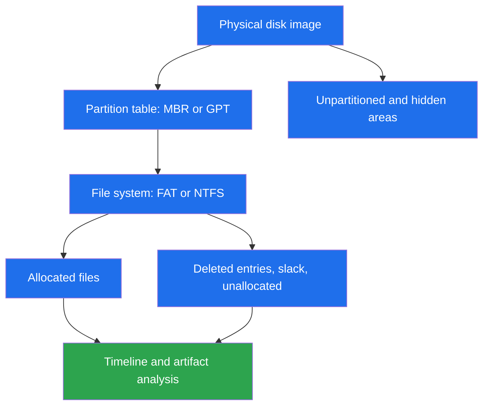

# Disk Partitions and File System Forensics (MBR, GPT, FAT, NTFS)

## Summary

Forensic tools show you files, but files are an interpretation. Underneath is a disk with a partition table, and inside each partition a file system with its own metadata structures. An examiner who understands those layers can find data that the operating system no longer shows: deleted files whose metadata still exists, data in unallocated space and slack, hidden areas outside any partition, and raw-disk tricks used by attackers (T1006 Direct Volume Access, T1564.005 Hidden File System).

## Layer 1: partition schemes

| Scheme | Key facts (per Microsoft's GPT FAQ) | Forensic notes |
|---|---|---|
| **MBR** | Partition table in sector 0; supports only four partition table entries | Look for gaps between partitions and after the last one |
| **GPT** | Introduced with UEFI; a **protective MBR** in sector 0 holds a single type `0xEE` partition spanning the disk, so MBR-only tools don't treat the disk as empty | UEFI systems must boot from a GPT disk; check both the primary and backup GPT |

A disk uses one scheme or the other. Every GPT disk still has the protective MBR.

## Layer 2: hidden areas on the drive

**Host Protected Area (HPA)** and **Device Configuration Overlay (DCO)** are drive features that can make part of the disk invisible to the OS by reporting a smaller capacity. Imaging tools should detect and, where appropriate, include them. (Unverified against the ATA specification; see open issues.)

## Layer 3: file systems

### FAT

Simple and still everywhere on USB media and SD cards. A directory entry points to the first cluster, and the File Allocation Table chains the rest. Deleting a file marks the directory entry and frees the clusters, but the data usually stays until overwritten, which is why deleted-file recovery on FAT often works. **Slack space**, the unused end of the last cluster of a file, can hold leftovers of earlier data.

### NTFS

NTFS keeps a file called the **Master File Table (MFT)**. Microsoft's documentation states there is at least one MFT entry for every file on the volume, and all information about a file (size, timestamps, permissions and data content) is stored either in MFT entries or in space outside the MFT described by those entries. For investigators the MFT is a goldmine: entries for deleted files persist until reused, and each entry carries timestamps that feed timelines.

## Working practice

- Image the **whole physical disk**, not just a logical volume, so partition gaps and unallocated space are preserved.
- Compare the partition table with the disk size to spot unaccounted space.
- Parse the MFT directly rather than relying only on a directory listing.
- Remember that file deletion (T1070.004) usually removes the reference, not the data.

## ATT&CK mapping

- **T1006 Direct Volume Access**: reading the raw volume to bypass file-system controls.
- **T1564.005 Hidden File System**: data hidden outside normal partitions or in custom file systems.
- **T1070.004 File Deletion**: the anti-forensic step that recovery techniques counter.

See also [Timeline Analysis and Execution Artifacts](timeline-analysis-and-execution-artifacts.md).

## Explanation

A disk is a library. The partition table is the floor plan; the file system is the card catalogue. Deleting a file usually just tears up the catalogue card: the book stays on the shelf until someone needs the space. Forensics is walking the shelves instead of trusting the catalogue.
