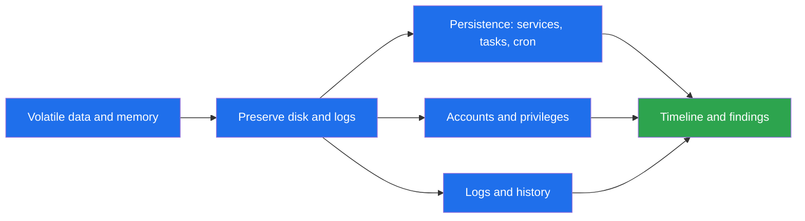

# Investigating Windows and Unix Systems

## Summary

Host investigation answers three questions about a suspect machine: **was it compromised, how, and what did the attacker do?** The method is the same on every platform: collect volatile data first, then preserve disks and logs, then examine the operating-system-specific places where attackers leave traces, especially persistence and privilege changes. The source chapters date from the Windows 2000/XP era; the categories of evidence still hold, while the specific artifacts have grown. This page is a checklist that points to the detailed pages in this knowledge base.

## Order of work

1. **Volatile data first**: running processes, network connections, logged-on users, and a memory image. See [Live Response and Triage Collection](live-response-and-triage-collection.md).
2. **Preserve**: disk image and logs before anything is changed.
3. **Examine** the OS-specific artifacts below.
4. **Build a timeline** that joins them. See [Timeline Analysis and Execution Artifacts](timeline-analysis-and-execution-artifacts.md).

## Windows: where to look

| Evidence | What it tells you | Detail |
|---|---|---|
| **Security event log** | Logons, process creation (4688), service installation attempts (4697), scheduled task creation (4698) | [Windows Event Logs and Security Auditing](windows-event-logs-and-security-auditing.md) |
| **Registry** | Autoruns, recently used files, USB devices, user activity | [Registry Forensic Artifacts](registry-forensic-artifacts.md) |
| **File system timestamps** | When tools were dropped and run | [Disk Partitions and File System Forensics](disk-partitions-and-file-system-forensics.md) |
| **Services and scheduled tasks** | Persistence (T1543.003, T1053.005) | Compare against a known-good baseline |
| **Browser history** | Downloads, phishing pages, webmail | Per-browser databases in the user profile |
| **Memory** | Injected code, hidden processes, command history | [Memory Forensics and Volatility](memory-forensics-and-volatility.md) |

## Unix/Linux: where to look

| Evidence | What it tells you |
|---|---|
| **System logs** (authentication and syslog) | Logins, `sudo` use, service starts |
| **User accounts** | New accounts, UID 0 accounts other than root, changed shells |
| **Shell history** | Commands typed (see [Command History Recovery](command-history-recovery.md)) |
| **cron and systemd timers** | Scheduled persistence (T1053.003) |
| **SUID/SGID binaries** | New or changed set-user-ID files that grant root (T1548.001) |
| **System binaries** | Trojanised `ls`, `ps`, `netstat` that hide the attacker; verify with the package manager's integrity check or a trusted toolkit |
| **Kernel modules** | Loadable-module rootkits (T1014) |

## Practical rules

- **Don't trust the compromised system's own tools.** Rootkits and trojanised binaries lie; run trusted binaries from external media or analyse the image offline.
- **Baseline beats intuition**: compare services, tasks, SUID files and accounts against a known-good build.
- **Record everything** you run and when, so your actions can be told apart from the attacker's.

## ATT&CK mapping

- **T1543.003 Windows Service**, **T1053.005 Scheduled Task**, **T1053.003 Cron**: common persistence to check.
- **T1548.001 Setuid and Setgid**: Unix privilege abuse.
- **T1014 Rootkit**: hidden processes, files and modules.

## Explanation

Investigating a host is like inspecting a house after a break-in. Before anyone tidies up, you photograph everything (volatile data). Then you check the doors (logons), the spare keys (accounts and privileges), anything left behind to let the burglar back in (persistence), and whether the burglar replaced your security cameras with ones that show an empty room (rootkits).
