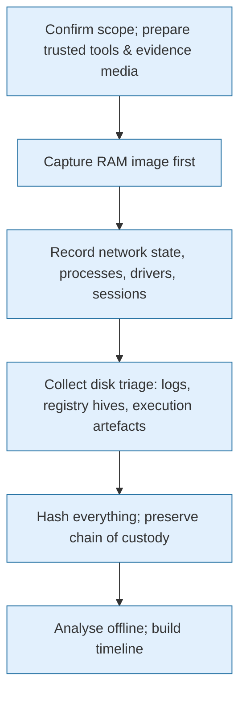

# Live Response and Triage Collection

## Summary

Live response is the disciplined collection of evidence from a running system during an incident, before the machine is shut down or reimaged. Its purpose is to capture **volatile** data that disappears on power-off — RAM, running processes, open network connections, logged-on users, loaded drivers — alongside fast-changing artefacts, in a way that minimises changes to the system and preserves the ability to analyse further. The guiding principle is the **order of volatility**: collect the most perishable evidence first (memory and network state) before the more durable (disk artefacts, logs). Done carelessly, live response destroys the very evidence it seeks; done well, it is often the difference between understanding an intrusion and losing it at shutdown.

## Order of volatility (collect in this order)

| Priority | Evidence | Why first |
|---|---|---|
| **1** | RAM / memory image | Vanishes at power-off; holds fileless malware, keys, injection |
| **2** | Network connections, routing, ARP | Live C2/sessions change second-to-second |
| **3** | Running processes, loaded modules/drivers, handles | Reflect current attacker activity |
| **4** | Logged-on users, sessions | Change with activity |
| **5** | Disk artefacts, event logs, registry | More durable; collect after volatile data |

The rule exists because every action an investigator takes also changes the system, so grab what evaporates fastest before your own activity (or a shutdown) erases it.

## Triage flow

## Key practices

- **Capture memory before anything else** volatile is lost.
- **Use trusted, known-good tools** run from your own media (a compromised host's binaries may lie).
- **Minimise footprint**: prefer read-only collection; record exactly what you did and when.
- **Hash and document** every artefact for integrity and chain of custody.
- **Don't reboot or "just run AV"** before collecting volatile evidence — both destroy it.

## Defense / IR guidance

- **Pre-stage triage tooling** (collection scripts, memory acquisition) so response is fast and consistent.
- **Automate triage collection** with vetted frameworks/EDR to reduce human error and footprint.
- **Centralise and preserve** collected data for correlation and later analysis.
- **Train responders** on order of volatility and evidence handling before an incident.
- **Integrate with EDR**, which can collect much of this remotely and continuously.

## ATT&CK mapping

No single ATT&CK technique; live response is an investigative/defensive process used to detect and analyse adversary techniques documented elsewhere.

## Explanation

Responding to a live intrusion is like arriving at a scene where some of the evidence is written in disappearing ink. The suspect's footprints in RAM, the phone call still connected to their accomplice (the network session), the tools currently in their hands (running processes) — all of it fades the instant the power is cut, and some of it even as you walk through the room. So responders follow a strict order: photograph the disappearing ink first (image memory), note the live call, then the durable things like the ledgers and logbooks that will still be there tomorrow. And because a compromised machine may have a lying narrator, investigators bring their own trusted tools rather than asking the suspect's own staff what happened. The cardinal sin is the instinctive "just reboot it and run a scan" — that wipes exactly the evidence that mattered most.
