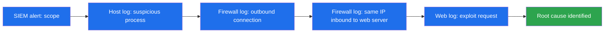

# Log Analysis for Incident Investigation

## Summary

A SIEM tells you **that** something is wrong and roughly **where**. Root cause, meaning how the attacker got in and what they did, usually needs an analyst to read the underlying logs and join them together. The key skill is **correlation**: each log source holds a piece of the story, and the answer from one log tells you which log to open next. Host, firewall and web server logs are the core sources.

## The main log families

| Source | Useful for | Windows examples |
|---|---|---|
| **Operating system** | Process starts, logons, service and task changes, log tampering | Security event 4688 (a new process was created); 1102 (the audit log was cleared) |
| **Firewall / proxy** | Which internal host talked to which external address, when, on what port, and how much data moved | Vendor-specific; join on IP and time |
| **Web server** | Requests that hit an application, including attack strings | IIS logs (W3C and other formats), default directory `%SystemDrive%\inetpub\logs\LogFiles` |
| **Linux** | Authentication, `sudo`, service and kernel messages | Syslog / journal |

## Correlation in practice

A typical chain, of the kind incident-response courses use as a worked example:

1. **Host evidence** shows a suspicious process starting (event 4688, or an execution artifact) and contacting an external address.
2. **Firewall logs** confirm the connection, the port, and that the traffic was encrypted (T1071 Application Layer Protocol).
3. The external address also connected **into** an internal web server, which points to that server's logs.
4. **Web server logs** show the initial attack, for example SQL injection against a public application (T1190).

## Watch for log tampering

Event **1102** is generated every time the Windows Security audit log is cleared. Attackers clear logs to cover their tracks (T1685.005 Clear Windows Event Logs), so a 1102 on a server is an incident signal in itself, and a gap in log continuity deserves the same attention. Forward logs off-host so clearing a local log doesn't destroy the evidence.

## Practical rules

- **Normalise time first**: confirm each source's time zone and clock drift before joining.
- **Pivot on stable keys**: IP address, host name, user name, process ID plus start time.
- **Preserve early**: copy logs before rotation or an attacker removes them.
- **Learn one vendor format well**; others mostly differ in field names.

## ATT&CK mapping

- **T1190 Exploit Public-Facing Application**: the entry point often found in web logs.
- **T1685.005 Clear Windows Event Logs**: tampering revealed by event 1102.
- **T1071 Application Layer Protocol**: C2 traffic seen in firewall and proxy logs.

See also [Windows Event Logs and Security Auditing](windows-event-logs-and-security-auditing.md).

## Explanation

Each log is one witness who saw only part of the street. The host saw someone leave the house, the firewall saw a car drive off, the web server saw someone try the back door an hour earlier. Alone, each statement is vague. Lined up by time, they tell the whole story.
