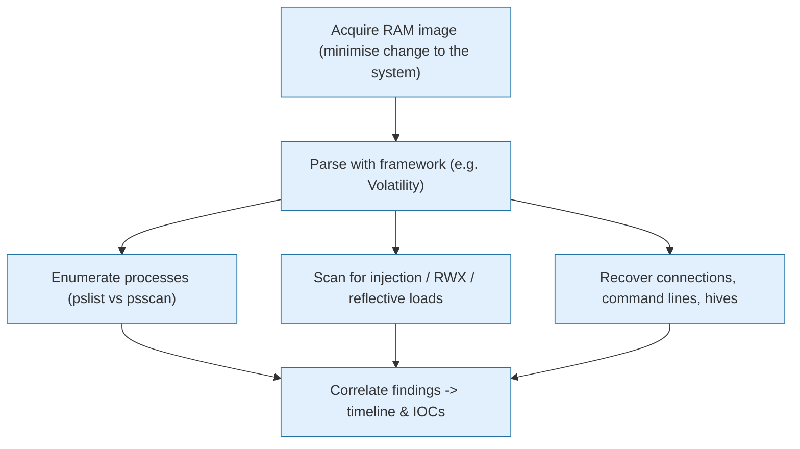

# Memory Forensics (RAM Analysis and Volatility)

## Summary

Memory forensics is the analysis of a system's physical RAM, captured as an image, to find evidence that never touches disk or that a live, possibly-compromised OS would hide. RAM holds running processes, network connections, injected code, decrypted payloads, command history, and kernel structures — exactly the things fileless malware and rootkits rely on being transient. Because the analysis reads the memory image directly rather than asking the (potentially lying) operating system, it reveals process injection (T1055), reflectively-loaded code with no file on disk (T1620), and rootkit hiding (T1014). Frameworks such as Volatility parse the image into processes, DLLs, connections, and kernel objects. Memory forensics is the counter to "it's only in memory, so you can't catch it."

## What memory reveals

| Evidence | Why it matters |
|---|---|
| **Process & DLL lists (incl. hidden)** | Compare pslist vs psscan to spot DKOM-hidden processes |
| **Injected / RWX regions** | Code injected into legitimate processes (T1055) |
| **Reflectively-loaded modules** | Executable memory with no backing file (T1620) |
| **Network connections** | Beacons and C2 live even when the host hides them |
| **Command lines, handles, registry in memory** | Attacker activity and loaded hives |
| **Kernel objects** | Pool scanning finds rootkit-hidden structures |

The key property: memory is captured once and analysed offline, so the rootkit cannot filter what the analyst sees — the image is ground truth.

## Analysis flow

## Detection (what to look for in an image)

- Hidden processes (present in object scan but not in the linked list) — a rootkit/DKOM indicator.
- Injected code: private executable (RWX) memory, hollowed processes, or modules not backed by a file.
- Suspicious parent/child relationships and command lines captured in memory.
- Live C2 connections and in-memory artefacts of fileless malware.

## Defense / investigative use

- **Acquire memory early** in incident response, before shutdown, to preserve volatile evidence.
- **Use memory forensics as ground truth** against rootkits and fileless threats that live-OS tools miss.
- **Integrate with EDR**, which can capture or flag in-memory anomalies continuously.
- **Preserve image integrity** (hashing, chain of custody) for reliable analysis and legal use.
- **Combine with disk and log forensics** to build a full timeline.

## ATT&CK mapping

| ID | Name | Tactic |
|---|---|---|
| T1055 | Process Injection | Privilege Escalation, Stealth |
| T1620 | Reflective Code Loading | Stealth |
| T1014 | Rootkit | Stealth |

(Memory forensics is an investigative method used to detect these techniques.)

## Explanation

A computer's RAM is its short-term memory: everything it is actually thinking about right now — the programs really running, the conversations open on the network, the secrets it just decrypted — lives there and nowhere else, and vanishes the moment the power goes off. Clever malware exploits this by refusing to write itself to disk, living only in that short-term memory where a disk scan can't reach. Memory forensics calls the bluff: take a perfect snapshot of RAM and study it on a clean machine, where the malware has no power to hide anything. Because the snapshot is just data, a process that erased itself from every on-screen list is still plainly there in the picture — which is why "it only lives in memory" stopped being a safe place to hide.
