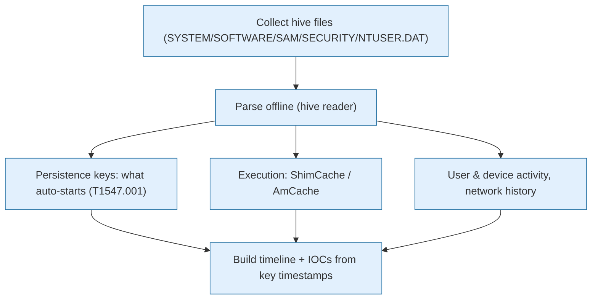

# Registry Forensic Artifacts

## Summary

The Windows registry is one of the richest sources of forensic evidence because so much system and user activity leaves traces there, each key carrying a last-write timestamp. Investigators mine it to reconstruct what ran, what was connected, what the user did, and how an attacker persisted. Attackers in turn query the registry for recon (query registry, T1012) and plant persistence in it (e.g. Run keys, T1547.001). Knowing the high-value keys — autostart locations, program-execution artefacts (ShimCache/AmCache), connected-device and network history, and user activity lists — turns the registry from a configuration store into a timeline of the machine's life. Analysis is usually done on collected hive files offline, so a live rootkit cannot filter the results.

## High-value artefact categories

| Category | Example evidence |
|---|---|
| **Persistence** | Run/RunOnce, Services, Winlogon, COM CLSIDs (what auto-starts) |
| **Program execution** | ShimCache (AppCompatCache) and AmCache (binaries that ran/were present) |
| **User activity** | UserAssist, RecentDocs, typed paths, MRU lists |
| **Devices/network** | USBSTOR, MountedDevices, known networks/profiles |
| **System config** | Computer name, time zone, installed software, control sets |

Key-write timestamps let an analyst order events; artefacts like ShimCache and AmCache are especially valuable because they can show a program existed/ran even after the file is deleted.

## Investigative flow

## Detection / investigative value

- Reconstruct persistence (what the attacker set to auto-run) and program execution history.
- Recover evidence of deleted binaries via ShimCache/AmCache.
- Trace user actions, opened files, mounted USB devices, and connected networks.
- Use key last-write times to order events into a timeline.

## Defense / collection guidance

- **Enable registry auditing** on high-value keys so changes are logged in real time.
- **Baseline autostart extensibility points** and alert on new entries (persistence).
- **Collect hives for offline analysis** in IR rather than trusting a live, possibly-compromised OS.
- **Restrict remote registry** and protect sensitive hives (SAM/SECURITY).
- **Correlate registry artefacts** with event logs, memory, and disk for a complete picture.

## ATT&CK mapping

| ID | Name | Tactic |
|---|---|---|
| T1012 | Query Registry | Discovery |
| T1547.001 | Boot or Logon Autostart Execution: Registry Run Keys / Startup Folder | Persistence, Privilege Escalation |

## Explanation

The registry is the machine's diary, and unlike a tidy diary it records far more than its owner realises: which programs were launched, which USB sticks were plugged in, which networks it joined, which documents were opened, and — crucially — roughly when, because almost every entry is stamped with the time it was last written. For an investigator that makes it a goldmine: even if an attacker deletes their malware, the diary often still notes that the program was there and ran. The best practice is to lift the diary pages (the hive files) and read them on a clean machine, so nothing on the suspect system can quietly tear pages out while you read.
