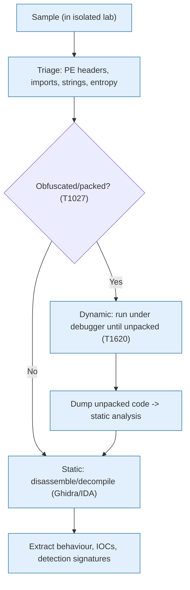

# Reverse Engineering Tooling (Ghidra, IDA, WinDbg, x86/x64)

## Summary

Reverse engineering is working backwards from a compiled binary to understand what it does, which is essential for malware analysis, vulnerability research, and detection engineering. The core tooling falls into three roles: **disassemblers/decompilers** (Ghidra, IDA) that translate machine code into assembly and higher-level pseudocode for static study; **debuggers** (WinDbg, x64dbg) that run or attach to code and step through it dynamically; and a working knowledge of **x86/x64 assembly and the PE format** to make sense of both. Analysts use these to extract indicators, understand capabilities, and defeat obfuscation (obfuscated files or information, T1027) and in-memory-only payloads (reflective code loading, T1620). This file orients the toolset and workflow rather than teaching a specific tool.

## The toolset

| Role | Tools | Use |
|---|---|---|
| **Disassembler / decompiler** | Ghidra, IDA | Static view: control flow, strings, imports, pseudocode |
| **Debugger** | WinDbg, x64dbg | Dynamic: step execution, inspect memory/registers, dump unpacked code |
| **Kernel debugging** | WinDbg (kernel mode) | Analyse drivers/rootkits, live kernel state |
| **Foundational knowledge** | x86/x64 assembly, PE format, Windows APIs | Interpret everything above |

Static and dynamic analysis complement each other: packers and obfuscation defeat pure static reading, but a debugger can run the sample until it unpacks itself in memory, then dump the real code for static analysis.

## Analysis workflow

## Investigative value

- Determine a sample's capabilities (persistence, C2, injection) without running it in production.
- Extract IOCs (domains, mutexes, keys) and build detection signatures (YARA, behavioural rules).
- Analyse exploits and vulnerable code paths for patching and detection.
- Study rootkits/drivers via kernel debugging.

## Defense / safe-practice guidance

- **Analyse only in an isolated, instrumented lab** (no production network; snapshots for rollback).
- **Combine static and dynamic analysis** to handle packing/obfuscation.
- **Turn findings into detections**: YARA rules, Sigma/behavioural analytics, and IOC feeds.
- **Document capabilities and IOCs** for responders and hunters.
- **Keep tooling updated** and handle live malware with care (containment, least privilege).

## ATT&CK mapping

| ID | Name | Tactic |
|---|---|---|
| T1027 | Obfuscated Files or Information | Stealth |
| T1620 | Reflective Code Loading | Stealth |

(Reverse engineering is the analysis method used to understand and defeat these techniques.)

## Explanation

A compiled program is a recipe translated into a language only the processor speaks — all nouns and verbs stripped out, leaving pure mechanical steps. Reverse engineering translates it back toward something a human can follow. Disassemblers and decompilers (Ghidra, IDA) are the dictionaries that turn those mechanical steps into readable assembly and rough pseudocode, letting an analyst read the recipe without cooking it. Debuggers (WinDbg, x64dbg) do the opposite: actually cook the dish one step at a time in a sealed kitchen, watching what goes into each pot. The two together beat the common trick of writing the recipe in invisible ink that only appears once cooking starts (packing) — you let it cook just until the ink appears, then photograph the page. The payoff is understanding exactly what a piece of malware does, which is what turns a mysterious file into concrete detections.
