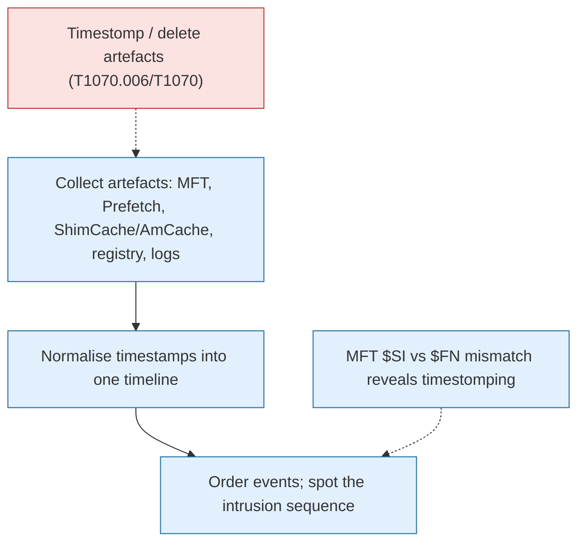

# Timeline Analysis and Execution Artifacts

## Summary

Timeline analysis reconstructs the order of events on a system by combining timestamped artefacts from many sources — the filesystem (MFT), program-execution traces (Prefetch, ShimCache, AmCache), registry key writes, event logs, and browser/user activity — into a single chronological view. This is how an investigator answers "what happened, in what order, and when." Windows leaves surprisingly durable execution artefacts: Prefetch files record that and when a program ran, and MFT entries carry multiple timestamps. Attackers fight timelines by deleting artefacts and by timestomping — altering file times to blend in or mislead (indicator removal: timestomp, T1070.006; indicator removal, T1070). Knowing which artefacts exist, and that the MFT keeps two timestamp sets, lets analysts detect that tampering.

## Core timeline artefacts

| Artefact | What it shows |
|---|---|
| **MFT (`$STANDARD_INFORMATION` vs `$FILE_NAME`)** | File timestamps; the two sets diverging hints at timestomping |
| **Prefetch** | That a program executed, run count, and last run times |
| **ShimCache / AmCache** | Presence/execution of binaries (survive deletion) |
| **Registry key write times** | When persistence/config changed |
| **Event logs** | Logons, process creation, service/task events |
| **USN Journal / $LogFile** | File-system change records |

The MFT dual-timestamp trick is key: many timestomping tools change the easily-visible `$STANDARD_INFORMATION` times but not the `$FILE_NAME` times, so a mismatch is evidence of tampering.

## Building and defending a timeline

## Detection

- **Timestomping**: `$STANDARD_INFORMATION` vs `$FILE_NAME` timestamp mismatches; implausible or identical timestamps on attacker files.
- **Artefact gaps**: deleted Prefetch/logs or discontinuities suggesting indicator removal.
- **Execution evidence**: Prefetch/ShimCache/AmCache showing a binary ran even after deletion.
- **Cross-source inconsistencies** (e.g. a file "created" after it supposedly executed).

## Defense / investigative guidance

- **Collect multiple timestamp sources** so tampering one doesn't erase the truth (MFT $FN, logs, Prefetch).
- **Forward logs off-host** and preserve the USN Journal for change history.
- **Use execution artefacts** (Prefetch/AmCache) to prove deleted binaries ran.
- **Preserve evidence integrity** (imaging, hashing) and correlate across disk, memory, and logs.
- **Hunt for timestomping** as an indicator-removal signal in its own right.

## ATT&CK mapping

| ID | Name | Tactic |
|---|---|---|
| T1070 | Indicator Removal | Stealth |
| T1070.006 | Indicator Removal: Timestomp | Stealth |

## Explanation

Reconstructing an incident is detective work, and a timeline is the detective's corkboard: every scrap of evidence pinned in the order it happened. Windows is a generous witness — it scatters timestamped notes everywhere, from the filesystem's master index to little "this program ran" receipts (Prefetch) that linger even after the program is deleted. Attackers try to forge the clock, back-dating their files so they blend into old, trusted ones. But Windows keeps two separate sets of file timestamps, and most forgers only change the one you see first; the second set still tells the truth, so the mismatch itself becomes a clue. The investigator's craft is gathering enough independent witnesses that no single forged alibi can hold.
