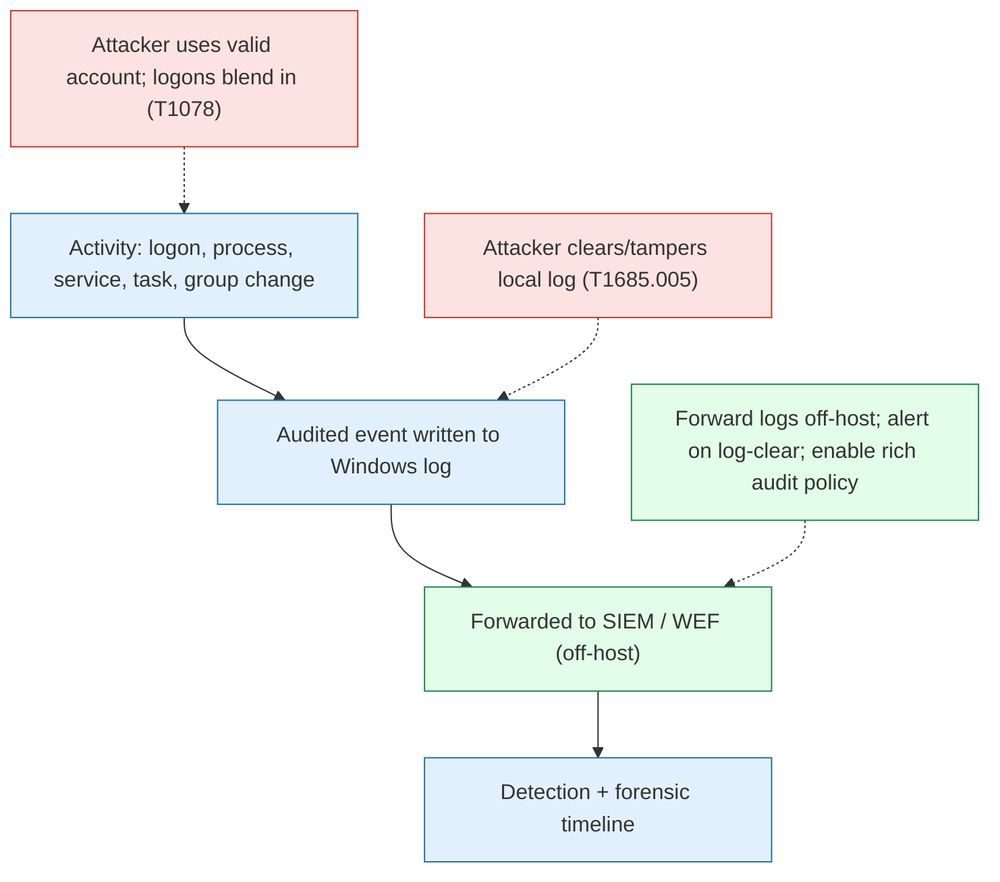

# Windows Event Logs and Security Auditing

## Summary

Windows records security-relevant activity to event logs, and well-configured audit policy turns them into the backbone of detection and forensics. Logon activity, process creation, privilege use, account and group changes, service installs, and scheduled-task creation all produce event IDs that let defenders reconstruct an intrusion. Because the logs are so valuable, they are also a target: attackers abuse valid accounts whose logons blend into normal activity (valid accounts, T1078) and clear or tamper with the logs to cover tracks (clear Windows event logs, T1685.005). The defensive essentials are enabling the right auditing (it is not all on by default), forwarding logs off the host so they survive tampering, and knowing the key event IDs.

## Key event IDs

| Event | Meaning |
|---|---|
| **4624 / 4625** | Successful / failed logon (type reveals interactive, network, remote) |
| **4672** | Special privileges assigned at logon (admin-equivalent) |
| **4688** | Process creation (with command line, if enabled) |
| **4697 / 7045** | Service installed |
| **4698** | Scheduled task created |
| **4720 / 4728 / 4732** | Account created / added to a (global/local) group |
| **1102 / event-log cleared** | Security log cleared (T1685.005) — a tamper signal |

Two caveats make auditing a project, not a checkbox: command-line logging (4688) and many useful categories are off by default and must be enabled, and a host's own logs can be cleared, so forwarding them elsewhere is essential.

## Logging and tampering

## Detection

- **Log clearing** (Security log cleared / event 1102) and gaps in continuous logs — strong tamper indicators.
- **Anomalous logons** (4624/4625): unusual hours, source hosts, logon types, or spraying patterns; 4672 for unexpected privileged logons.
- **Suspicious process creation** (4688) with attacker-like command lines and parents.
- **Account and group changes** (4720/4728/4732), service installs (7045), and task creation (4698) outside change windows.

## Defense

- **Enable a strong audit policy** (logon, process creation with command line, privilege use, object access where needed) — much is off by default.
- **Forward logs off-host** (Windows Event Forwarding / SIEM) so clearing the local log doesn't destroy evidence.
- **Alert on log clearing** and on continuity gaps.
- **Protect accounts** (MFA, Protected Users, tiering) to blunt valid-account abuse.
- **Retain logs** long enough for investigation and correlate across hosts.

## ATT&CK mapping

| ID | Name | Tactic |
|---|---|---|
| T1078 | Valid Accounts | Initial Access, Persistence, Privilege Escalation, Stealth |
| T1685.005 | Disable or Modify Tools: Clear Windows Event Logs | Defense Impairment |

## Explanation

Event logs are the building's CCTV and sign-in sheets combined: who came in, when, which doors they opened, what they switched on. The catch is twofold. First, a lot of the cameras ship switched off, so you have to deliberately turn on the coverage you need — command-line recording especially. Second, a smart intruder knows the tapes exist and will try to wipe them, or simply walk in wearing a real employee's badge so the footage looks routine. The two defences follow directly: stream the footage to an off-site recorder the intruder can't reach (so wiping the local tape changes nothing), and treat a suddenly-blank tape as an alarm in itself.
