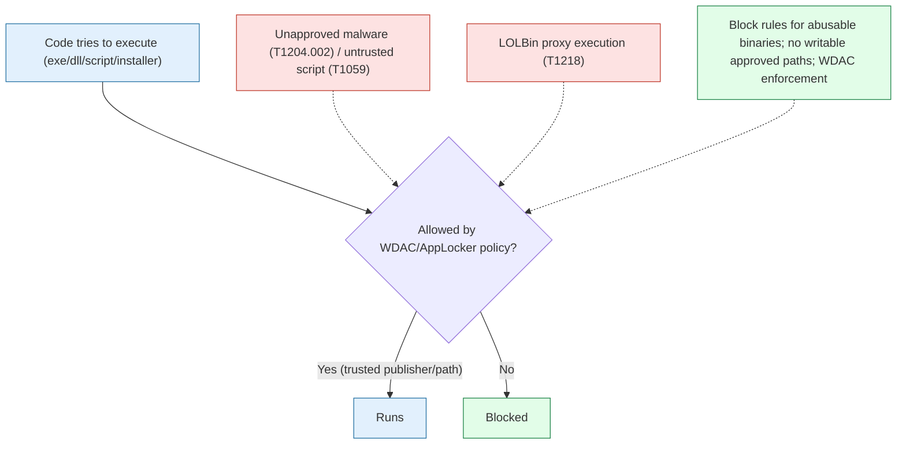

# Application Control (WDAC and AppLocker)

## Summary

Application control flips the default from "run anything not known to be bad" to "run only what is explicitly approved" — an allowlist. On Windows the two mechanisms are **AppLocker** (policy-based rules by path, publisher, or hash) and the stronger **Windows Defender Application Control (WDAC)**, which enforces code integrity at the kernel level and is much harder to bypass. Effective application control stops a huge range of attacks at the execution step: unapproved executables and installers (malicious file, T1204.002), script interpreters running untrusted code (command and scripting interpreter, T1059), and the abuse of trusted system binaries to proxy execution (system binary proxy execution / LOLBins, T1218). The hard part is doing allowlisting well — blocking the known bypasses (certain LOLBins, writable approved paths) — which is why WDAC's tighter enforcement and curated block rules matter.

## The two mechanisms

| Mechanism | Nature |
|---|---|
| **AppLocker** | Rules by path / publisher / file hash; user-mode enforcement |
| **WDAC** | Kernel-enforced code integrity policy; stronger, harder to bypass |
| **Rule bases** | Allow trusted publishers/paths; deny everything else |
| **Microsoft recommended block rules** | Curated deny-list of abusable binaries (LOLBins) to pair with allowlisting |

Allowlisting is powerful but only as good as its gaps: a writable "approved" directory, or an allowed LOLBin that can launch arbitrary code, undoes it — so mature policies combine allowlisting with the recommended block rules and avoid user-writable approved paths.

## Enforcement flow

## Detection / value

- **Blocks unapproved execution** outright — malware, unsigned tools, untrusted installers.
- **Audit mode** surfaces what *would* be blocked, revealing unexpected/unauthorised software.
- **Constrains scripting and LOLBins** when paired with language-mode restrictions and block rules.
- Policy-block events are high-signal indicators of attempted unauthorised execution.

## Defense / deployment

- **Prefer WDAC** (kernel-enforced) for strong control; use AppLocker where WDAC isn't feasible.
- **Start in audit mode**, build the allowlist from real usage, then enforce.
- **Apply Microsoft's recommended block rules** for known-abusable binaries (LOLBins).
- **Avoid user-writable approved paths**; prefer publisher/signature rules over path rules.
- **Constrain PowerShell** (Constrained Language Mode under WDAC) and monitor policy-block events.

## ATT&CK mapping

| ID | Name | Tactic |
|---|---|---|
| T1059 | Command and Scripting Interpreter | Execution |
| T1218 | System Binary Proxy Execution | Stealth |
| T1204.002 | User Execution: Malicious File | Execution |

(Application control is a mitigation against these execution techniques.)

## Explanation

Most computers run on a trusting rule: anything is allowed unless we've specifically heard it's bad. Application control inverts that to the far safer rule a secure facility uses: nobody gets in unless they're on the guest list. Done properly, this stops an enormous amount of trouble at the door — the random malicious download, the unsigned hacking tool, the booby-trapped installer — because none of them are on the list. The catch is the catch with any guest list: a side door left unlocked (a folder users can write to that's still "approved"), or a trusted caterer who'll smuggle anyone in (a legitimate Windows binary that can be coaxed into running other code — a LOLBin). That's why strong application control isn't just an allowlist; it's an allowlist plus a short banned-list of those smuggler binaries, enforced deep enough (WDAC) that attackers can't simply talk their way past the bouncer.
