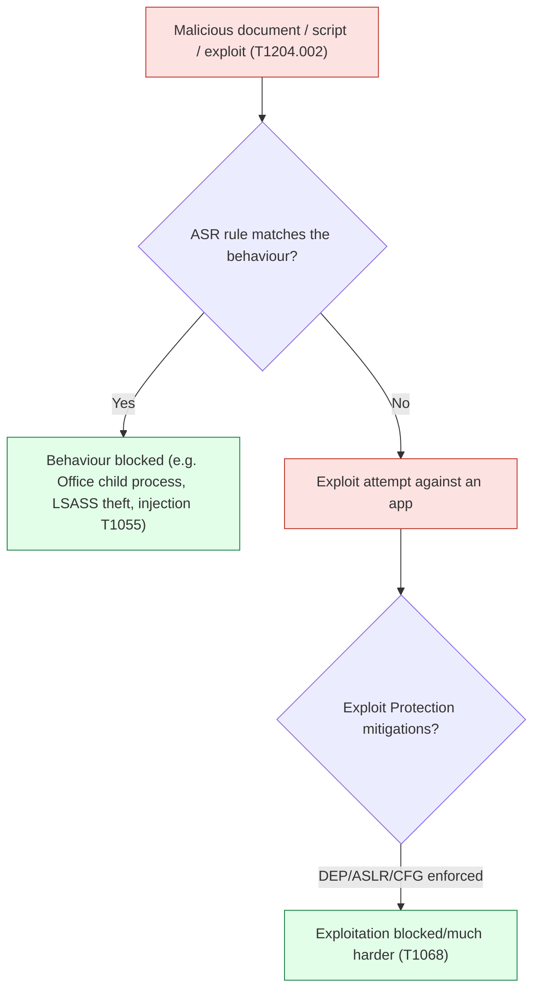

# Attack Surface Reduction and Exploit Protection

## Summary

Attack Surface Reduction (ASR) and Exploit Protection are built-in Windows/Defender controls that block common attack behaviours and harden applications against exploitation — without needing to identify specific malware. **ASR rules** target the behaviours malware relies on: Office apps spawning child processes or injecting code, scripts launching downloaded executables, credential theft from LSASS, and abuse of common delivery vectors (malicious file, T1204.002; process injection, T1055). **Exploit Protection** applies per-process mitigations (DEP, ASLR, CFG, and more) to make memory-corruption exploitation harder (exploitation for privilege escalation, T1068), including forcing mitigations onto legacy apps that don't opt in. Both are high-leverage because they stop whole classes of technique at the behaviour or exploitation layer, rather than chasing individual samples.

## What they block

| Control | Targets |
|---|---|
| **ASR: Office child process / injection rules** | Office spawning processes or injecting (T1055) |
| **ASR: script/executable rules** | Scripts launching downloaded content, obfuscated scripts |
| **ASR: credential protection rule** | Theft of credentials from LSASS |
| **ASR: delivery-vector rules** | Risky email/USB/exploit-kit behaviours |
| **Exploit Protection** | DEP, ASLR, CFG, mandatory ASLR, etc. per-app (T1068) |

The value is categorical: one ASR rule blocks the "Office document launches PowerShell" pattern regardless of which malware uses it, and Exploit Protection makes exploitation of a whole class of bugs harder across many applications at once.

## Where they intervene

## Detection / value

- **Blocks behaviour classes** (Office→process, script→download→run, LSASS theft, injection) regardless of specific malware.
- **ASR audit mode** reveals which legitimate workflows would be affected before enforcing.
- **Exploit Protection** hardens apps against memory-corruption exploitation broadly.
- ASR block events are strong signals of attempted malicious behaviour.

## Defense / deployment

- **Enable ASR rules** (start in audit, then enforce) — especially Office child-process/injection, script, and LSASS-credential rules.
- **Configure Exploit Protection** system-wide and per-app; use mandatory ASLR / force integrity for legacy software.
- **Pair with app control, Credential Guard, and EDR** for layered coverage.
- **Tune in audit mode** to avoid breaking legitimate workflows, then enforce.
- **Monitor ASR/Exploit-Protection events** as high-value detections.

## ATT&CK mapping

| ID | Name | Tactic |
|---|---|---|
| T1204.002 | User Execution: Malicious File | Execution |
| T1055 | Process Injection | Privilege Escalation, Stealth |
| T1068 | Exploitation for Privilege Escalation | Privilege Escalation |

(ASR and Exploit Protection are mitigations against these techniques.)

## Explanation

Instead of trying to recognise every individual burglar, ASR and Exploit Protection outlaw the burglar's standard moves. A huge share of attacks follow a handful of well-worn patterns: a Word document that suddenly launches a command shell, a script that downloads and runs a program, a tool reaching into the credential vault. ASR says "that specific move is forbidden here," full stop, no matter who's attempting it — so whole families of malware that all rely on the same opening gambit die at the first step. Exploit Protection works the other side of the street, reinforcing the windows and doors of your applications (DEP, ASLR, CFG) so that even a determined attacker with a genuine flaw finds it far harder to climb through. Neither needs to know the burglar's name; they just make the common break-in techniques stop working.
