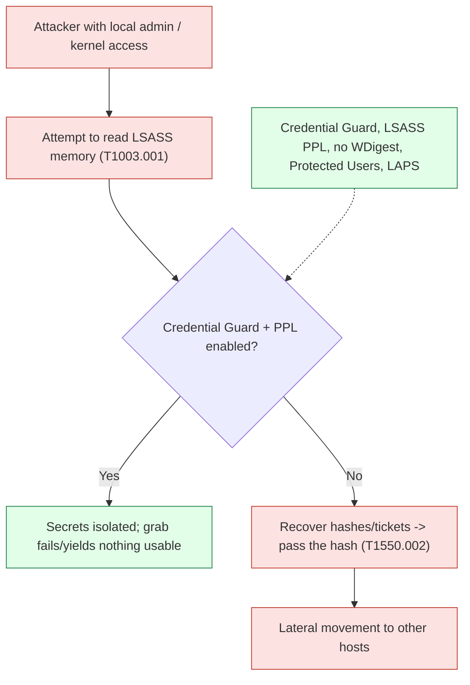

# Credential Protection (Credential Guard and LSASS Hardening)

## Summary

The Local Security Authority Subsystem Service (LSASS) holds the secrets of logged-on users — password hashes, Kerberos tickets, and cached credentials — which makes it the single richest target for credential theft on Windows (OS credential dumping: LSASS memory, T1003.001). Stolen hashes and tickets then enable lateral movement without cracking anything (pass the hash, T1550.002). **Credential Guard** defends this by moving LSA secrets into the VBS-isolated secure region, so even a kernel-level attacker cannot read them from LSASS memory. Complementary hardening includes running LSASS as a Protected Process Light (PPL), disabling WDigest (which stored reversible credentials), and applying least privilege. Together these aim to ensure that compromising one machine does not hand the attacker reusable credentials to spread.

## Protections

| Control | Effect |
|---|---|
| **Credential Guard (VBS)** | Isolates NTLM hashes/Kerberos TGTs so LSASS memory theft can't recover them |
| **LSASS as PPL** | Blocks tampering/reading of LSASS by non-protected processes |
| **Disable WDigest** | Stops storage of reversible (plaintext-equivalent) credentials in memory |
| **Protected Users group** | Removes NTLM/weak-crypto exposure for high-value accounts |
| **LAPS** | Randomises/rotates local admin passwords so a stolen one has limited reach |

The strategy is layered: Credential Guard removes the prize from reach, PPL stops the grab, disabling WDigest removes a legacy weakness, and LAPS limits the blast radius if something is still stolen.

## Credential theft vs protection

## Detection

- **LSASS access** by unusual processes (handle opens with read rights) — a strong credential-theft signal.
- Attempts to **disable Credential Guard, PPL, or re-enable WDigest**.
- **Pass-the-Hash indicators**: NTLM network logons for an account from unexpected hosts without a preceding interactive logon.
- Known credential-dumping tool behaviour and memory-access patterns.

## Defense

- **Enable Credential Guard** (VBS) and run **LSASS as PPL**; keep WDigest disabled.
- **Add privileged accounts to Protected Users** and deploy **LAPS** for local admin passwords.
- **Least privilege and tiered administration** so few accounts expose high-value credentials on reachable hosts.
- **Monitor LSASS access** and alert on protections being disabled.
- **Prefer Kerberos, restrict NTLM** to shrink reusable-credential exposure.

## ATT&CK mapping

| ID | Name | Tactic |
|---|---|---|
| T1003.001 | OS Credential Dumping: LSASS Memory | Credential Access |
| T1550.002 | Use Alternate Authentication Material: Pass the Hash | Lateral Movement |

## Explanation

When you log into a Windows machine, it keeps your credentials in a back room (LSASS) so it doesn't have to ask for your password again all day. That back room is the first place an intruder with admin rights heads, because grabbing what's inside lets them impersonate you on every other machine without ever learning your actual password — copy the key, no need to pick the lock. Credential Guard answers this by moving the back room into the hypervisor's sealed vault, so even an attacker who owns the kernel can't open it. The surrounding measures pile on: lock the door to the room itself (PPL), stop an old habit of leaving a plaintext spare lying around (disable WDigest), and make sure that even a stolen key opens only one door, not the whole estate (LAPS and tiering). The aim is that breaching one computer never automatically breaches the next.
