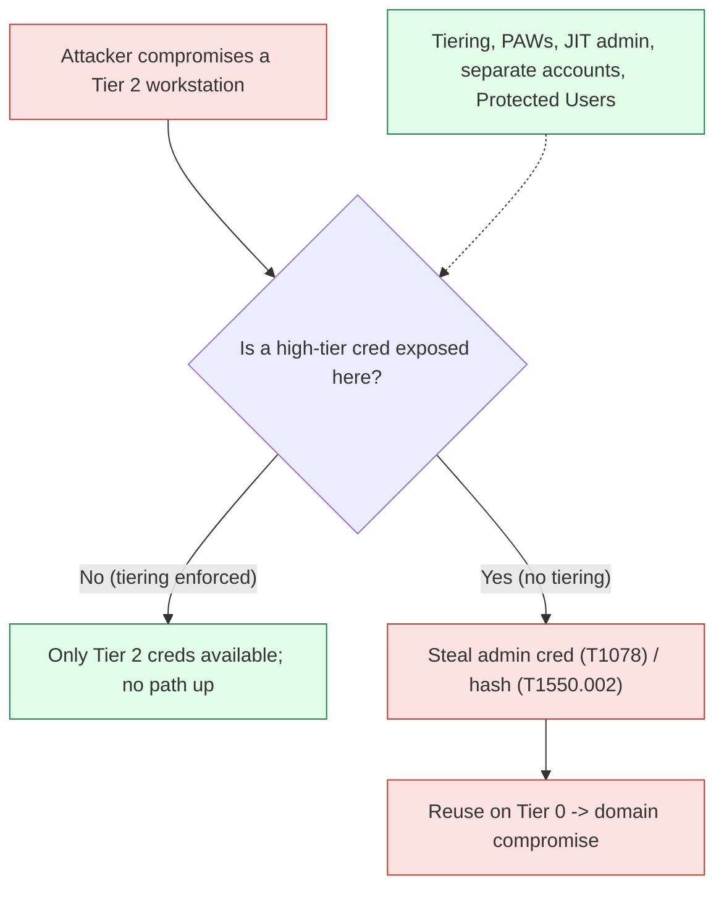

# Privileged Access Management and Administrative Tiering

## Summary

Most catastrophic Windows compromises come down to one pattern: a high-privilege credential is exposed on a machine an attacker can reach, so stealing it from there grants the keys to the kingdom. Administrative tiering and privileged access management (PAM) are the structural defences against this. **Tiering** separates administration into levels — Tier 0 (domain controllers, identity systems), Tier 1 (servers), Tier 2 (workstations) — and forbids high-tier credentials from ever logging on to lower-tier (reachable, more-exposed) hosts, so a compromised workstation can never yield Domain Admin. **PAM** adds just-in-time, time-bound, audited elevation and privileged access workstations (PAWs) for admin tasks. Together they break the credential-theft-to-escalation chain that valid-account abuse (T1078) and pass-the-hash (T1550.002) depend on.

## Core controls

| Control | Purpose |
|---|---|
| **Tier model (0/1/2)** | High-tier creds never exposed on lower-tier hosts |
| **Privileged Access Workstations (PAWs)** | Admin from hardened, dedicated devices only |
| **Just-in-time / just-enough admin** | Time-bound, scoped elevation instead of standing rights |
| **Separate admin accounts** | Distinct accounts for admin vs daily use; no email/browsing as admin |
| **Vaulting & session monitoring** | Check-out, rotate, and audit privileged credential use |

The decisive rule is the "clean source / no exposure" principle: a credential is only as safe as the least-trusted machine it logs on to, so Tier 0 credentials must never touch a Tier 2 workstation.

## Why tiering breaks the chain

## Detection

- High-tier accounts logging on to lower-tier hosts (a tiering violation) — alert on it.
- Privileged logons outside PAWs or approved sources/times.
- Unusual use of admin accounts (interactive logons where only service use is expected).
- Pass-the-Hash / lateral-movement patterns involving privileged accounts.

## Defense

- **Implement the tier model** and enforce logon restrictions so high-tier creds never reach exposed hosts.
- **Use PAWs** and **just-in-time, just-enough administration** to minimise standing privilege.
- **Separate admin and daily-use accounts**; never browse or read email as an admin.
- **Add admins to Protected Users**, deploy LAPS, and vault/rotate privileged credentials.
- **Monitor and alert** on tiering violations and anomalous privileged logons.

## ATT&CK mapping

| ID | Name | Tactic |
|---|---|---|
| T1078 | Valid Accounts | Initial Access, Persistence, Privilege Escalation, Stealth |
| T1550.002 | Use Alternate Authentication Material: Pass the Hash | Lateral Movement |

(Tiering and PAM are mitigations against credential-reuse escalation.)

## Explanation

Imagine the master key to every building in a city. The one unbreakable rule is: never, ever carry that master key into a corner shop that gets robbed every week. The moment you do, the next robbery hands over the whole city. Administrative tiering is that rule made into architecture. The most powerful credentials (Tier 0 — the keys to the identity system) are only ever used from a few hardened, trusted places and are forbidden from logging on to ordinary workstations, which are the corner shops attackers breach first. So when an attacker does pop a laptop, all they find are laptop-level keys — annoying, but not the kingdom. Pair that with handing out powerful keys only briefly, for a specific job, from a dedicated secure device (PAWs and just-in-time admin), and the classic one-laptop-to-Domain-Admin path simply has no rungs to climb.
