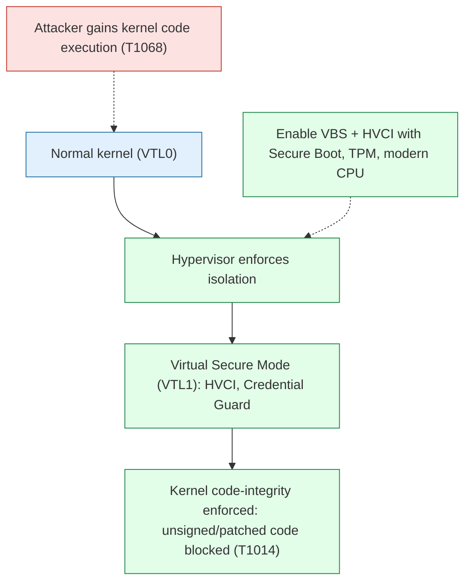

# Virtualization-Based Security (VBS, HVCI, Device Guard)

## Summary

Virtualization-Based Security (VBS) uses the CPU's hardware virtualization to carve out an isolated, more-trusted memory region ("virtual secure mode") that even the Windows kernel cannot freely access. Security-critical functions run there, protected from a compromised kernel. The best-known consumer is **HVCI** (Hypervisor-Protected Code Integrity, also called Memory Integrity), which moves kernel code-integrity checks into that protected region so that only properly signed code can execute in the kernel — directly undercutting kernel exploits and rootkits that try to load unsigned code or patch kernel memory (exploitation for privilege escalation, T1068; rootkit, T1014). Credential Guard (its own file) is another VBS consumer. VBS raises the bar dramatically: many kernel-level compromises that used to succeed are stopped or made far harder.

## What VBS protects

| Feature | Protection |
|---|---|
| **VBS (virtual secure mode)** | Isolated memory the normal kernel can't tamper with |
| **HVCI / Memory Integrity** | Enforces kernel code integrity from the protected region (blocks unsigned/patched kernel code) |
| **Credential Guard** | Isolates LSA secrets (see its own file) |
| **Hardware root of trust** | Pairs with Secure Boot, TPM, and modern CPU features |

HVCI's core effect: even if an attacker gains kernel execution, they cannot simply map unsigned code as executable or patch protected kernel memory, because the integrity decision lives in a region their kernel foothold can't reach.

## How VBS isolates trust

## Defensive value

- **Blocks unsigned/tampered kernel code**, undercutting many kernel exploits and rootkits (HVCI).
- **Isolates credentials** (with Credential Guard), defeating LSASS secret theft.
- **Resists kernel memory patching** even after a kernel foothold.
- **Complements** Secure Boot, driver blocklists, and PatchGuard for defence in depth.

## Defense / deployment

- **Enable VBS and HVCI (Memory Integrity)** on supported hardware across the estate.
- **Pair with Secure Boot, TPM, and the vulnerable-driver blocklist** for a hardware-rooted chain.
- **Test driver compatibility** (HVCI requires well-behaved, properly-signed drivers) before broad rollout.
- **Enable Credential Guard** alongside to protect secrets.
- **Monitor** for VBS/HVCI being disabled (a tamper signal).

## ATT&CK mapping

| ID | Name | Tactic |
|---|---|---|
| T1068 | Exploitation for Privilege Escalation | Privilege Escalation |
| T1014 | Rootkit | Stealth |

(VBS/HVCI is a mitigation against these techniques, not an attack.)

## Explanation

Normally the Windows kernel is the ultimate authority on the machine, which is a problem the day an attacker manages to run code inside it — the fox is now guarding the henhouse. VBS changes the arrangement by using the CPU's virtualization to build a small, sealed vault that sits *beneath* even the kernel, run by the hypervisor, that the kernel cannot open. The most important thing kept in that vault is the rulebook deciding which code is allowed to run in the kernel (HVCI). So even after an attacker takes over the kernel, they can't rewrite the rulebook or sneak unsigned code past it, because the rulebook lives somewhere their takeover doesn't reach. It doesn't make kernel compromise impossible, but it removes many of the easy wins that used to follow from it.
