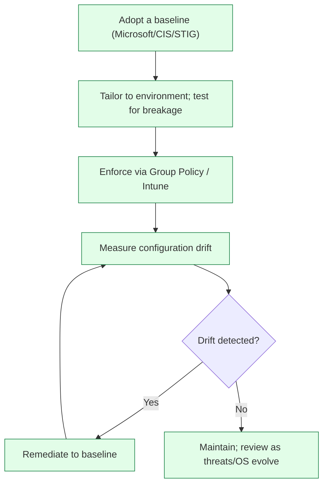

# Windows Security Baselines and Hardening

## Summary

A security baseline is a vetted, consistent configuration applied across machines to reduce attack surface and close common weaknesses before an attacker finds them. Rather than hand-tuning each setting, organisations adopt a published baseline (Microsoft Security Baselines, CIS Benchmarks, or DISA STIGs) and enforce it through Group Policy or an MDM like Intune, then measure drift. Hardening covers disabling legacy protocols and features, enforcing strong authentication and UAC, restricting administrative tooling, enabling the platform security features (described in their own files), and turning on auditing. The value is uniformity and proven defaults: a well-baselined estate removes the easy footholds (weak NTLM, open shares, excessive privileges, unmonitored scripting) that misconfiguration-based attacks depend on.

## What hardening covers

| Area | Typical measures |
|---|---|
| **Authentication** | Restrict/disable NTLMv1, enforce SMB/LDAP signing, Protected Users, MFA |
| **Legacy attack surface** | Disable LLMNR/NBT-NS, SMBv1, PowerShell v2, unneeded services |
| **Admin & privilege** | Least privilege, UAC Always Notify, restrict dangerous privileges |
| **Execution control** | App control (WDAC/AppLocker), ASR rules, macro restrictions |
| **Platform security** | VBS/HVCI, Credential Guard, Secure Boot, tamper protection |
| **Visibility** | Strong audit policy, log forwarding |

The point of using a published baseline is leverage: experts have already decided safe values for hundreds of settings, so you inherit good defaults and spend effort on enforcing and monitoring them rather than researching each one.

## Baseline lifecycle

## Defensive value

- **Removes common footholds** (legacy protocols, weak auth, excess privilege) at scale.
- **Consistency**: every machine starts from the same hardened state, easing detection of anomalies.
- **Proven defaults** from expert-maintained baselines reduce guesswork.
- **Drift detection** catches weakening of controls over time.

## Practices

- **Adopt and tailor a reputable baseline** (Microsoft Security Baselines / CIS / STIG) rather than ad-hoc settings.
- **Enforce centrally** (Group Policy / Intune) and **measure drift** continuously.
- **Test before rollout** to avoid breaking legitimate workflows.
- **Layer the platform security features** (VBS, Credential Guard, app control, ASR).
- **Review regularly** as the OS and threat landscape change.

## ATT&CK mapping

No single ATT&CK technique; baselines and hardening reduce attack surface across many techniques (NTLM relay/Pass-the-Hash, UAC bypass, LOLBin execution, credential theft) documented in their own files.

## Explanation

Hardening is the difference between a house built to code and one thrown together with whatever was lying around. Left to chance, every machine ends up with its own accidental weaknesses — an old lock here, a window that never shut there — and attackers make a living finding those accidents. A security baseline is a published building code written by people who've seen every way houses get broken into: it specifies safe settings for hundreds of details at once, so instead of debating each lock you apply the whole proven standard and move on. The real work then isn't choosing settings but enforcing them everywhere and noticing when one quietly drifts back to "insecure," because a baseline that isn't maintained slowly rots back into the pile of accidents it replaced.
