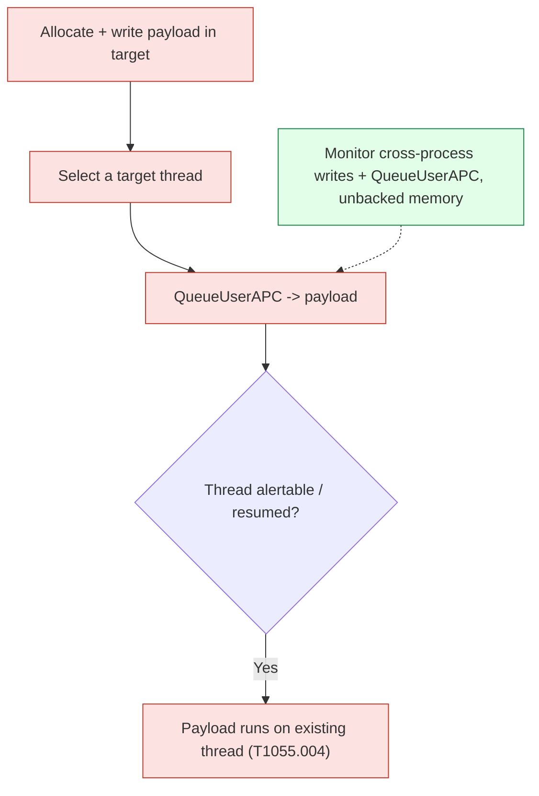

# APC Injection

## Summary

An Asynchronous Procedure Call (APC) is a Windows mechanism that queues a function to run in the context of a specific thread when that thread enters an alertable state. APC injection abuses this: an attacker allocates payload code in a target process and queues an APC on one of its threads so the payload runs without ever calling `CreateRemoteThread` (process injection: asynchronous procedure call, T1055.004). Because it rides an existing thread, it is quieter than creating a new remote thread. The "early bird" variant queues the APC before the process's main thread starts, so the payload runs very early.

## How it works

| Step | Primitive |
|---|---|
| **Allocate + write payload** | `VirtualAllocEx` + `WriteProcessMemory` in the target |
| **Find a thread** | Identify a target thread (or create the process suspended) |
| **Queue the APC** | `QueueUserAPC` pointing at the payload |
| **Trigger** | The thread runs the APC when it becomes alertable (or on resume, for early bird) |

No new thread is created, which avoids the most-watched injection indicator; instead an existing thread is nudged into running attacker code.

## Attack flow

## Detection

- Cross-process `VirtualAllocEx`/`WriteProcessMemory` not followed by a remote thread but by APC queuing.
- Executable, unbacked memory regions in a target process whose threads then execute them.
- Processes created suspended by an unusual parent, then resumed after memory manipulation (early bird pattern).
- EDR telemetry on `QueueUserAPC`/`NtQueueApcThread` targeting other processes.

## Defense

- **Behavioural EDR** that correlates cross-process memory writes with APC queuing, not just remote-thread creation.
- **Scan for unbacked executable memory** and anomalous execution on otherwise idle threads.
- **Protected Process Light** for sensitive targets.
- **Code-integrity / ACG** to restrict dynamically introduced executable code.
- **Least privilege** so fewer processes can be opened and manipulated.

## ATT&CK mapping

| ID | Name | Tactic |
|---|---|---|
| T1055.004 | Process Injection: Asynchronous Procedure Call | Stealth, Privilege Escalation |

## Explanation

Windows lets you leave a sticky note for a specific worker that says "next time you pause, do this task" — that is an APC. APC injection is slipping a malicious note into a trusted worker's queue so that, the moment they take a breather, they run the attacker's errand as part of their normal day. Because no new worker is hired (no remote thread), the usual headcount alarm never trips. Defenders instead watch for the suspicious combination of someone writing into another worker's desk and then leaving them a note, and for workers suddenly executing code that came from nowhere.
