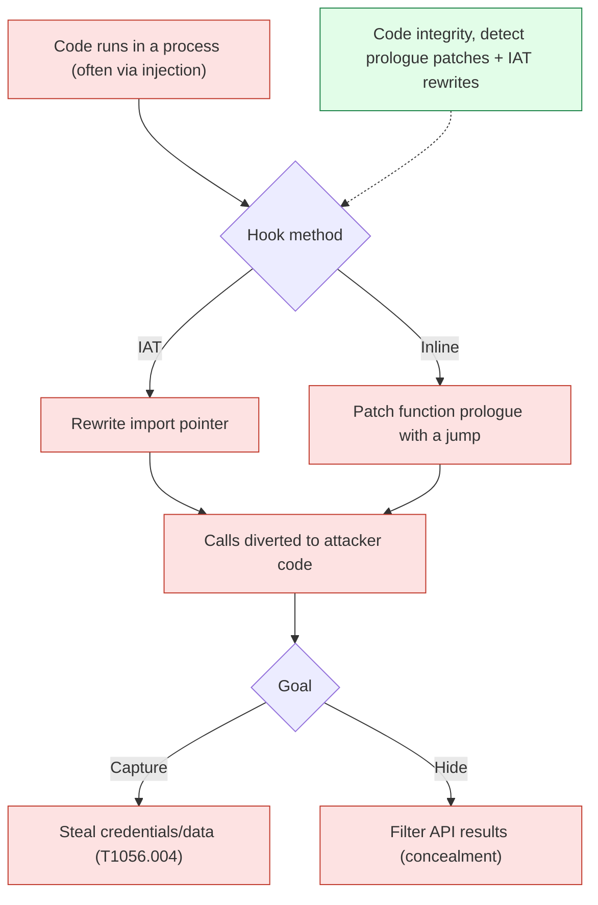

# API Hooking (IAT and Inline Hooks)

## Summary

API hooking redirects calls to a function so that attacker code runs first (and can observe or alter the call) before, or instead of, the real function. Malware uses it to intercept sensitive data such as credentials passed to API calls (input capture: credential API hooking, T1056.004), and to hide its presence by filtering what enumeration APIs return. The same technique is used legitimately by EDR products and debuggers — which is precisely why attackers also develop techniques to remove those defensive hooks. The two main forms are IAT hooking and inline hooking.

## Hook types

| Type | Mechanism |
|---|---|
| **IAT hooking** | Overwrite a function pointer in a module's Import Address Table so calls go to attacker code |
| **Inline (trampoline) hooking** | Patch the first bytes of the target function with a jump to attacker code, then jump back |
| **EAT hooking** | Alter a module's Export Address Table to redirect resolved addresses |
| **Purpose: interception** | Read credentials/data passed to the hooked API (T1056.004) |
| **Purpose: concealment** | Filter results of enumeration APIs to hide files, processes, keys (rootkit behaviour) |

Defensively, EDR places inline hooks on sensitive APIs to watch for malicious use; attackers "unhook" by restoring the original bytes (covered in [Direct Syscalls and EDR Bypass](../defense-evasion/direct-syscalls-and-edr-bypass.md)).

## Attack flow

## Detection

- Modified function prologues in loaded modules (bytes differing from the on-disk image), indicating inline hooks.
- IAT/EAT entries pointing outside the owning module's address range.
- Unbacked executable memory that hooked jumps target.
- Discrepancies between what an API returns and ground truth (cross-view analysis) suggesting concealment hooks.

## Defense

- **Integrity-check critical modules**: compare in-memory code of key DLLs (ntdll, kernel32) against disk to spot patched prologues.
- **Behavioural EDR** that itself monitors from kernel/ETW so it does not rely solely on userland hooks attackers can remove.
- **Cross-view analysis** to detect concealment (compare API-reported state to raw structures).
- **Application control and exploit protections** to limit untrusted code that would install hooks.
- **Protect credential-handling paths** and prefer kernel/ETW-based telemetry over hookable userland.

## ATT&CK mapping

| ID | Name | Tactic |
|---|---|---|
| T1056.004 | Input Capture: Credential API Hooking | Collection, Credential Access |
| T1574.001 | Hijack Execution Flow: DLL | Stealth, Execution |

## Explanation

Calling a Windows API is like dialing an internal extension; API hooking is quietly rewiring the switchboard so your call is first routed through an eavesdropper, who listens (stealing the password you spoke) or lies to you (reporting "no such file" to hide malware) before, maybe, connecting you properly. Security products wire the switchboard too, for good reasons, which is why attackers also learn to rip out the defender's taps. Defenders counter by regularly comparing the switchboard wiring to its blueprint and by listening from a vantage point (the kernel) that the attacker's userland rewiring cannot reach.
