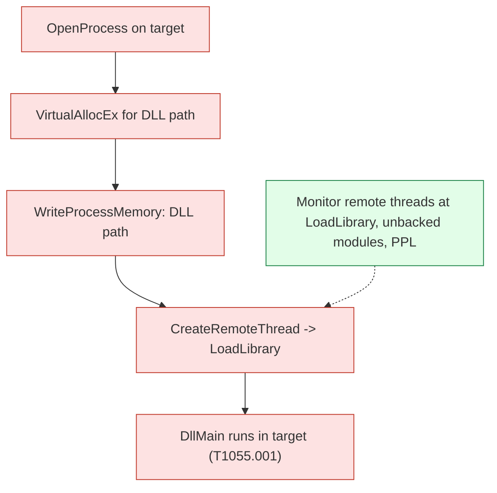

# DLL Injection

## Summary

DLL injection is the most classic form of process injection: force a target process to load a malicious dynamic-link library, so the attacker's code runs inside it. The canonical method writes the path of a DLL on disk into the target's memory and starts a remote thread at `LoadLibrary`, which loads the DLL and runs its `DllMain` (dynamic-link library injection, T1055.001). Variants load the DLL from memory (reflective loading) to avoid touching disk. It is popular because loading a DLL is a normal operation, so the malicious step blends into ordinary behaviour.

## How it works

| Step | Primitive |
|---|---|
| **Open the target** | `OpenProcess` with injection rights |
| **Allocate memory** | `VirtualAllocEx` for the DLL path string |
| **Write the path** | `WriteProcessMemory` writes the path of the DLL |
| **Load it** | `CreateRemoteThread` pointed at `LoadLibrary`, which loads the DLL |
| **Run** | The DLL's `DllMain` executes inside the target |

Reflective DLL injection skips `LoadLibrary` and maps the DLL directly from memory, leaving no DLL on disk and no module registered in the normal loaded-module list.

## Attack flow

## Detection

- Remote thread creation (Sysmon event 8) whose start address is `LoadLibrary`/`LdrLoadDll`.
- A module loaded into a process from an unusual path, or (for reflective injection) executable memory not backed by any file.
- Cross-process `WriteProcessMemory` followed by remote thread creation.
- Unexpected DLLs in processes that have no reason to load them.

## Defense

- **Behavioural monitoring** for the allocate-write-remote-thread sequence and `LoadLibrary` remote threads.
- **Protected Process Light** for sensitive processes to prevent injection.
- **Scan for unbacked executable memory** and modules not present in the module list (reflective injection).
- **Code-integrity controls** (WDAC/ACG) that restrict what code a process may load or generate.
- **Least privilege** to limit which processes an attacker can open for injection.

## ATT&CK mapping

| ID | Name | Tactic |
|---|---|---|
| T1055.001 | Process Injection: Dynamic-link Library Injection | Stealth, Privilege Escalation |

## Explanation

Every Windows program is built to accept add-on modules (DLLs) and run them — that is just how the platform works. DLL injection abuses that willingness by shoving an attacker's module into a running program and telling it "load this," at which point the program dutifully runs the attacker's code as part of itself. The stealthy version never even puts the module on disk, mapping it straight from memory. Defenders cannot ban module loading, so they watch for the tell-tale way injection does it — one process reaching into another to force a load — and lock down the most sensitive processes so nothing can reach in.
