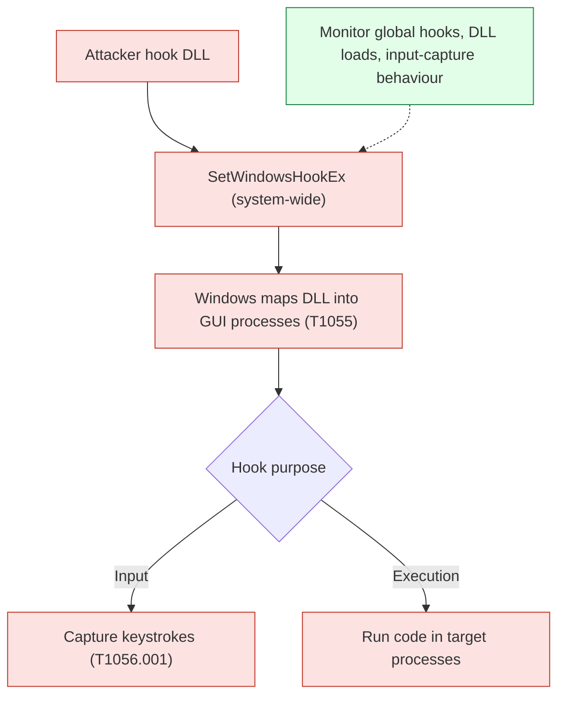

# Hook Injection (SetWindowsHookEx)

## Summary

`SetWindowsHookEx` installs a hook procedure into the message-handling chain of Windows GUI threads. When the hook lives in a DLL, Windows loads that DLL into every process that receives the hooked events, which is a built-in injection vector: the attacker's DLL ends up running inside other GUI processes (process injection, T1055). Hooks are also the classic way to intercept keyboard and mouse input, making this a common keylogging technique (input capture: keylogging, T1056.001). It abuses a legitimate, documented feature used by accessibility tools and input methods.

## How it works

| Step | Mechanism |
|---|---|
| **Write a hook DLL** | A DLL exporting a hook procedure (e.g. `WH_KEYBOARD_LL`, `WH_GETMESSAGE`) |
| **Install the hook** | `SetWindowsHookEx` registers it, optionally system-wide |
| **Windows injects** | The DLL is mapped into processes receiving the hooked messages |
| **Intercept / run** | The hook procedure runs in those processes, seeing input or messages |

A low-level keyboard hook sees keystrokes across the session, which is why this is a staple keylogger design; the global message hooks additionally provide code execution inside other processes.

## Attack flow

## Detection

- Installation of global/system-wide hooks, especially low-level keyboard/mouse hooks by non-accessibility software.
- A single DLL loaded into many unrelated GUI processes (hook-driven injection footprint).
- Processes reading or logging keystroke data, or writing keystroke logs to disk.
- Unusual modules in common GUI processes correlated with hook installation.

## Defense

- **Behavioural monitoring** for global hook installation and DLLs mapped broadly across GUI processes.
- **EDR keylogger detection**: flag low-level input hooks and keystroke-logging behaviour from untrusted code.
- **Application control (WDAC)** to prevent untrusted hook DLLs from loading.
- **Least privilege** and session isolation so a hook sees less, and protect credential entry (secure desktop for UAC).
- **Audit** which software installs hooks and remove unneeded ones.

## ATT&CK mapping

| ID | Name | Tactic |
|---|---|---|
| T1055 | Process Injection | Stealth, Privilege Escalation |
| T1056.001 | Input Capture: Keylogging | Collection, Credential Access |

## Explanation

Windows lets programs register to be notified of input and window messages — the feature that makes accessibility tools and input-method editors possible. `SetWindowsHookEx` with a DLL takes advantage of the fact that, to deliver those notifications, Windows loads your DLL into every program involved. So an attacker registers a "please tell me about every keypress" hook and, as a bonus, gets their code running inside lots of other programs. It is a legitimate door propped open for a dishonest purpose. Defenders watch for software installing these broad hooks when it has no business doing so, and for the keystroke-logging that usually follows.
