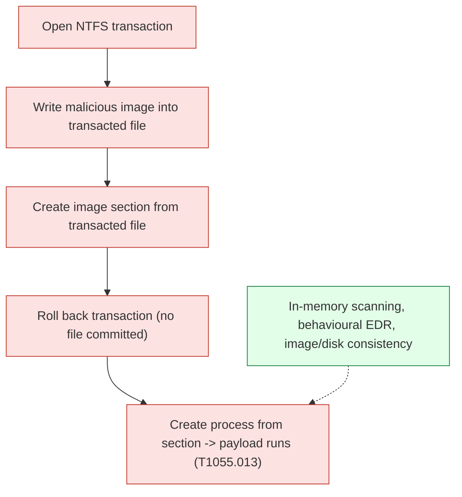

# Process Doppelgänging

## Summary

Process doppelgänging creates a process from a malicious image that is loaded inside an NTFS transaction and then rolled back, so no malicious file is ever committed to disk. The process runs the attacker's code while, to on-disk scanners, the file appears clean or absent (process injection: process doppelgänging, T1055.013). It abuses Transactional NTFS (TxF) to defeat antivirus that inspects the file on disk, and it leaves a process whose backing file does not match what executed.

## How it works

| Step | Mechanism |
|---|---|
| **Start a transaction** | Create a TxF transaction |
| **Write malicious image** | Write the payload into a file inside the transaction |
| **Create a section** | Make an image section from the transacted (uncommitted) file |
| **Roll back** | Abort the transaction so the malicious file is never committed |
| **Create process** | Build a process from the section, which runs the payload |

Because the file write is rolled back, static on-disk scanning finds nothing; the payload lives only in the process created from the transacted section. (The related "process herpaderping" and "ghosting" techniques exploit similar gaps between what is scanned and what runs.)

## Attack flow

## Detection

- Processes whose backing file is missing, rolled back, or inconsistent with the executing image.
- Use of Transactional NTFS APIs to create image sections, which is rare in benign software.
- Behavioural indicators after launch (network, injection, persistence) despite a clean on-disk scan.
- Image sections created from files that no longer exist on disk.

## Defense

- **Scan in memory and at process creation**, not only on-disk files, so rolled-back payloads are still inspected.
- **Behavioural EDR**: judge the process by what it does, since the file evidence is deliberately erased.
- **Monitor Transactional NTFS usage** for image creation, which legitimate software rarely does.
- **Application control (WDAC)** to restrict what may execute regardless of how it was staged.
- Keep EDR/AV updated, since vendors have added specific coverage for doppelgänging-class tricks.

## ATT&CK mapping

| ID | Name | Tactic |
|---|---|---|
| T1055.013 | Process Injection: Process Doppelgänging | Stealth, Privilege Escalation |

## Explanation

Doppelgänging exploits a gap between the moment antivirus looks at a file and the moment Windows runs it. The attacker writes the malicious file inside a "transaction" — a tentative change Windows lets you undo — builds a running program from that tentative file, then cancels the change so the file never truly existed on disk. The scanner, checking the disk, sees nothing; the process, built from the ghost file, runs the payload. The defence is to stop trusting the disk as the source of truth and instead inspect what is actually in memory and judge the process by its behaviour.
