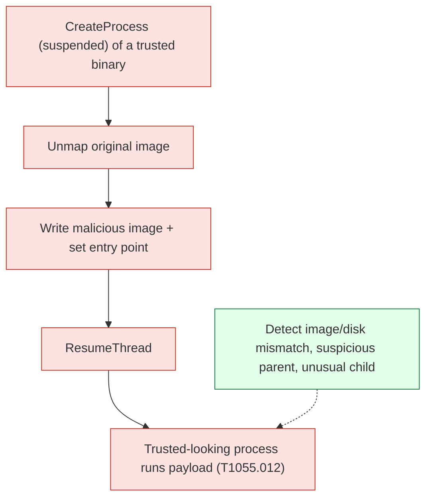

# Process Hollowing

## Summary

Process hollowing creates a legitimate process in a suspended state, then replaces (hollows out) its in-memory image with malicious code before letting it run. The result is a process that appears on disk and in the process list as a trusted program (say, `svchost.exe`) but is actually executing the attacker's payload (process injection: process hollowing, T1055.012). It is favoured for masquerading, because casual inspection of the process name and path looks entirely normal.

## How it works

| Step | Primitive |
|---|---|
| **Create suspended** | `CreateProcess` with `CREATE_SUSPENDED` for a legitimate target |
| **Unmap the image** | Hollow out the original image (`NtUnmapViewOfSection` or overwrite) |
| **Write payload** | Allocate and `WriteProcessMemory` the malicious image into the process |
| **Fix the entry point** | Set the thread context (`SetThreadContext`) to the payload's entry |
| **Resume** | `ResumeThread` runs the payload under the legitimate process identity |

The process keeps the trusted name and path, but its memory no longer matches the file on disk — the key detectable discrepancy.

## Attack flow

## Detection

- A process whose in-memory image does not match the file on disk (unmapped/replaced primary image).
- A trusted process created suspended by an unusual parent, with memory manipulation before resume.
- A well-known system binary running from or behaving inconsistently with its expected parent, path, or command line.
- Executable memory regions replacing the original image base.

## Defense

- **EDR that compares in-memory images to on-disk files** and flags mismatches at the image base.
- **Parent-child and command-line analysis**: a system binary spawned by an unusual parent, or with the wrong command line, is suspicious.
- **Monitor the create-suspended / unmap / write / set-context / resume sequence.**
- **Code integrity (WDAC)** to constrain what can run, and least privilege to limit targets.
- **Baseline legitimate process ancestry** so masqueraders stand out.

## ATT&CK mapping

| ID | Name | Tactic |
|---|---|---|
| T1055.012 | Process Injection: Process Hollowing | Stealth, Privilege Escalation |

## Explanation

Process hollowing is taxidermy for software: start a real, trusted program but freeze it before it draws breath, scoop out its insides, and stuff it with the attacker's payload — then let it "wake up." To anyone reading the label it is still the trusted program, running from the right place with the right name. The giveaway is that what is inside no longer matches what the label (the file on disk) promises. Defenders catch it by comparing the living process's guts to its on-disk blueprint and by noticing when a familiar system program was born to the wrong parent.
