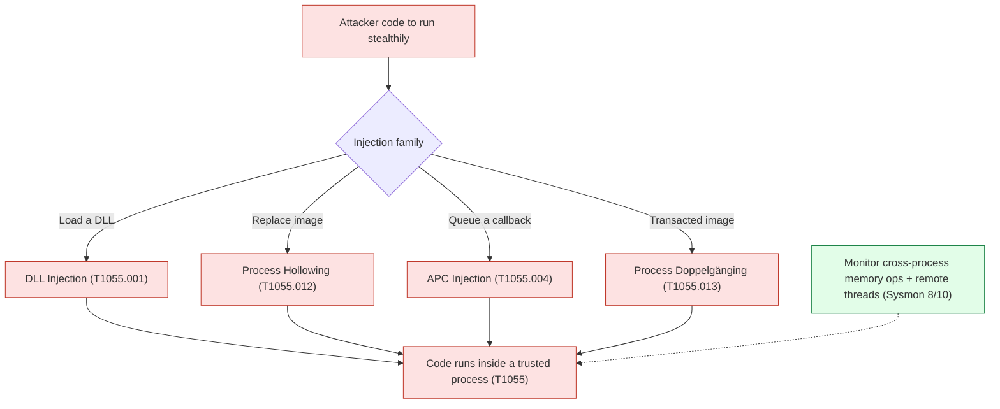

# Process Injection (Overview)

## Summary

Process injection is running attacker code inside the address space of another, legitimate process. It is a cornerstone of malware and offensive tooling because it hides execution behind a trusted process, may inherit that process's privileges, and evades defenses that watch for new malicious processes (process injection, T1055). The many named techniques — DLL injection, hollowing, APC injection, doppelgänging — are variations on the same three-part idea: get code into a target's memory, make it executable, and get a thread to run it.

## The common pattern

| Step | Typical Windows primitives |
|---|---|
| **Open/target a process** | `OpenProcess`, or create one suspended |
| **Allocate memory** | `VirtualAllocEx` in the target |
| **Write the payload** | `WriteProcessMemory` (code or a DLL path) |
| **Execute** | `CreateRemoteThread`, queue an APC, hijack a thread, or point execution at the payload |

The variants differ mainly in the execute step and in how they avoid touching memory in suspicious ways, but the goal is constant: run in someone else's process.

## Technique families

## Detection

- Cross-process memory operations: `VirtualAllocEx`/`WriteProcessMemory` into another process, and remote thread creation (Sysmon event 8).
- Process memory access with suspicious rights (Sysmon event 10), especially targeting sensitive processes.
- Executable memory in a process that is private and not backed by a file on disk (unbacked/floating code).
- A benign process suddenly making network connections or spawning children out of character.

## Defense

- **Behavioural EDR**: monitor for the injection API patterns and remote-thread creation rather than file signatures.
- **Protected Process Light (PPL)** for sensitive processes (LSASS) to block injection into them.
- **Exploit protections** (CFG, ACG, code integrity guard) that constrain dynamically introduced code where applications support them.
- **Scan for unbacked executable memory** and anomalous thread start addresses.
- **Least privilege** so injected code inherits little, and patch to remove the escalation that enables targeting privileged processes.

## ATT&CK mapping

| ID | Name | Tactic |
|---|---|---|
| T1055 | Process Injection | Stealth, Privilege Escalation |

## Explanation

Process injection is a burglar who, instead of walking in as themselves, climbs inside a trusted employee's uniform and does the work from within — so the security cameras see only the employee. Every variant is the same trick with a different way of slipping inside: hand the employee a bag to carry (a DLL), swap out the employee entirely while they are frozen (hollowing), or leave a note that makes them run an errand (an APC). Defenders stop watching the front door for strangers and instead watch for employees behaving out of character — writing into each other's pockets or sprouting threads they never normally have.
