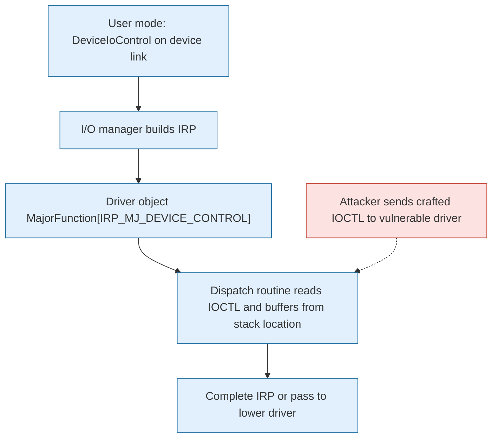

# Windows Kernel Driver Structure and IRP Handling

## Summary

A Windows kernel driver is a small, predictable set of parts: an entry point (`DriverEntry`), a **driver object** whose table of function pointers says which routine handles which kind of request, one or more **device objects** that user-mode code can open, and dispatch routines that process **I/O request packets (IRPs)**. Because the layout is fixed, an analyst reversing an unknown driver, whether a rootkit or a vulnerable third-party driver, can go straight to the dispatch table and the device-control handler, which is where both hidden functionality and exploitable bugs usually live.

## Anatomy of a driver

| Part | Role | Where to look when reversing |
|---|---|---|
| **`DriverEntry`** | Called by the I/O manager at PASSIVE_LEVEL in a system thread when the driver loads; initialises the driver | Fills in the driver object, creates devices and symbolic links, registers callbacks |
| **Driver object** (`DRIVER_OBJECT`) | Created by the I/O manager per loaded driver; holds entry points | `MajorFunction[]` array indexed by `IRP_MJ_*` code |
| **Device object** | What the driver exposes; requests are sent to a device | Name (e.g. under `\Device`) and the symbolic link user mode opens |
| **Dispatch routines** | Handle IRPs for each major function | `IRP_MJ_CREATE`, `IRP_MJ_CLOSE`, `IRP_MJ_READ`, `IRP_MJ_WRITE`, `IRP_MJ_DEVICE_CONTROL` |
| **Unload routine** | Frees resources when the driver is unloaded | Its absence means the driver cannot be unloaded cleanly |

## How an IRP flows

1. A user-mode program opens the device's symbolic link and calls `DeviceIoControl`, `ReadFile` or `WriteFile`.
2. The I/O manager builds an IRP with one **I/O stack location** per driver in the device stack and sends it to the top driver.
3. The driver's dispatch routine for that major function reads its stack location (`IoGetCurrentIrpStackLocation`) to get the parameters, such as the I/O control code (IOCTL) and buffer lengths.
4. The driver either completes the IRP or sets up the next stack location and passes it down to the lower driver, optionally registering a completion routine.

## Buffer methods (why IOCTL handlers are bug-prone)

Each IOCTL code encodes how buffers reach the driver:

- **METHOD_BUFFERED**: the I/O manager copies data through a system buffer. Safest.
- **METHOD_IN_DIRECT / METHOD_OUT_DIRECT**: the buffer is described by an MDL and mapped for the driver.
- **METHOD_NEITHER**: the driver receives raw user-mode addresses and must probe and validate them itself. Missing validation here is a classic source of kernel privilege escalation.

## Security relevance

- **Rootkits (T1014)** register dispatch routines to talk to their user-mode component through a private device, hook other drivers' `MajorFunction` tables to filter I/O, or attach as filter drivers in a device stack.
- **Driver services (T1543.003)**: drivers are installed as kernel services; a new service of type kernel driver is a persistence and privilege signal.
- **Vulnerable drivers (T1068)**: signed drivers with IOCTLs that read/write arbitrary memory or MSRs are the basis of bring-your-own-vulnerable-driver attacks (see Driver Signature Enforcement and BYOVD).

## Reversing checklist

- Locate `DriverEntry`, then the writes into the driver object's `MajorFunction` array.
- Find `IoCreateDevice` and `IoCreateSymbolicLink` to learn the device name user mode will open, and check its security descriptor.
- In the `IRP_MJ_DEVICE_CONTROL` handler, list every IOCTL code, its buffer method and what it does with user-supplied lengths and pointers.
- Compare the dispatch table of a suspect driver with its own code range; pointers into another module indicate hooking.

## ATT&CK mapping

- **T1014 Rootkit**
- **T1543.003 Windows Service** (driver installation)
- **T1068 Exploitation for Privilege Escalation** (vulnerable IOCTL handlers)

## Explanation

A driver is like a small shop with a fixed floor plan: a front door (the device link), a reception desk (`DriverEntry` set it up), and a board behind the desk listing which clerk handles which type of request (the dispatch table). Every customer arrives with a standard order form (the IRP). When you investigate a strange shop, you read the board first, then sit with the clerk who handles "special requests" (device control), because that is where shops either hide back-room business or accept forms they should have refused.
