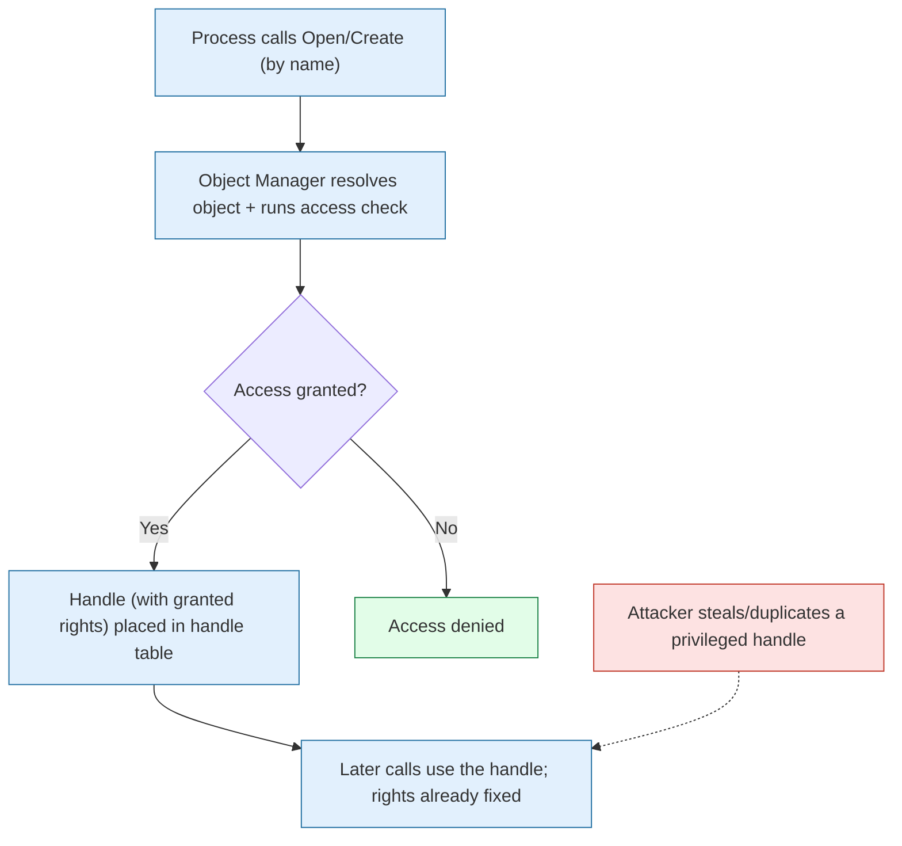

# Object Manager and Handles

## Summary

Nearly everything the Windows kernel manages — processes, threads, files, registry keys, events, mutexes, tokens, sections — is a **kernel object**, created and tracked by the **Object Manager**. User-mode code never touches these objects directly; it gets a **handle**, an opaque index into the process's handle table, and every use of that handle is subject to an access check against the object's security descriptor. This design is why permissions are enforced consistently across wildly different resource types, and why handles themselves are security-relevant: a leaked or duplicated privileged handle can hand an attacker access they were never granted, and enumerating handles reveals what a process can reach.

## Key ideas

| Concept | Meaning |
|---|---|
| **Kernel object** | A managed resource (process, file, token, section, event, …) with a type and security descriptor |
| **Handle** | A per-process reference to an object; index into the handle table |
| **Object namespace** | A hierarchy (e.g. `\Device`, `\BaseNamedObjects`) the Object Manager exposes |
| **Access check at open** | Rights are checked when a handle is opened, and the granted rights are baked into the handle |
| **Handle duplication** | A handle can be duplicated to another process (`DuplicateHandle`) |

Because access is evaluated when the handle is opened, a handle is effectively a capability: whoever holds it has the rights it was granted, which is what makes privileged-handle theft and leaks dangerous.

## Object/handle model

## Security relevance

- Handles are **capabilities**: a leaked privileged handle (e.g. a handle to a SYSTEM process or token) can be abused for escalation even without reopening the object.
- **Handle enumeration** reveals what a process can touch; attackers use it to find useful handles, defenders to spot suspicious ones.
- **Named objects** in the shared namespace can be squatted or abused for coordination; weak object ACLs can allow tampering.
- Duplicating a handle into another process is a quieter way to share access than reopening by name.

## Defense

- **Strong security descriptors** on objects so access checks deny unauthorised opens.
- **Least privilege** so processes do not hold more-powerful handles than they need.
- **Protect sensitive processes (PPL)** so their handles cannot be opened with dangerous rights.
- **Monitor** for processes opening handles to security-critical objects (LSASS, SYSTEM processes, sensitive registry keys) with write/clone rights.

## ATT&CK mapping

No single ATT&CK technique; the handle/object model underlies process access, token manipulation, and credential-access techniques covered elsewhere.

## Explanation

Imagine a vast building where you can never grab anything directly — not a file, not a door, not a tool. Instead you go to a central desk (the Object Manager), say what you want, and the clerk checks your ID against who's allowed. If you pass, they hand you a numbered ticket (a handle) that already encodes exactly what you may do with that item. From then on you just flash the ticket; nobody re-checks your ID. That makes tickets precious: a ticket that grants powerful access is as good as the access itself, so one dropped, copied, or handed to the wrong person is a real problem. Defenders keep the clerk strict about who gets which ticket, and watch for anyone holding a ticket to something they have no business touching.
