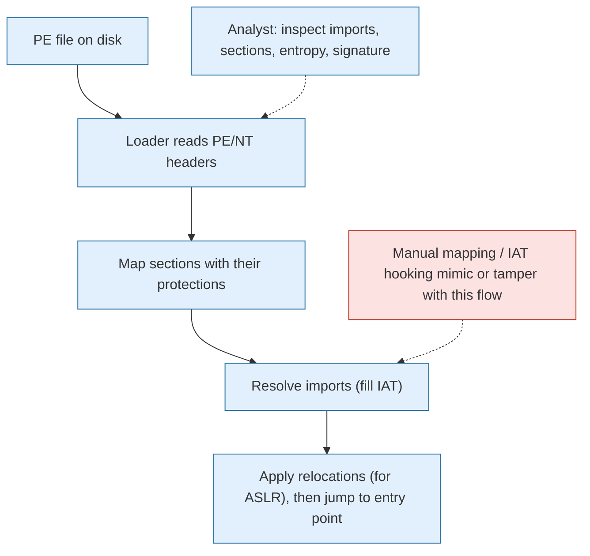

# PE File Format (Portable Executable)

## Summary

The Portable Executable (PE) format is the structure of Windows executables and libraries (`.exe`, `.dll`, `.sys`). It tells the loader how to map the file into memory, where execution starts, which libraries and functions it imports, what it exports, and how to fix up addresses. Malware analysts and detection engineers read PE structure constantly because so much is revealed there: suspicious imports, abnormal sections, packing, forged or missing signatures, and injection artefacts all show up in the headers and tables. Understanding the PE layout is the foundation for static malware analysis, loader/injection techniques (manual mapping replicates what the PE loader does), and signature/heuristic detection.

## Key structures

| Structure | Role |
|---|---|
| **DOS header + stub** | Legacy header; `e_lfanew` points to the PE header |
| **PE/NT headers** | File header (machine, section count) + optional header (entry point, image base, subsystem) |
| **Section table** | Defines sections (`.text` code, `.data`, `.rdata`, `.rsrc`, …) with their memory protections |
| **Import Address Table (IAT)** | Functions imported from other DLLs, resolved at load |
| **Export table** | Functions a DLL exposes to others |
| **Relocations** | Fixups applied if the image can't load at its preferred base (needed for ASLR) |
| **Certificate/security directory** | Holds the Authenticode signature, if signed |

The imports often betray intent: a tiny program importing `VirtualAllocEx`, `WriteProcessMemory`, and `CreateRemoteThread` is advertising injection; high section entropy suggests packing.

## Load and analysis view

## Security relevance

- **Static triage**: suspicious imports, abnormal/misnamed sections, high entropy (packing), and tiny code with large resources are red flags.
- **Signatures**: the certificate directory holds Authenticode data; missing, broken, or mismatched signatures matter.
- **Injection/loading**: manual mapping and reflective loading reproduce the PE loader's steps in memory to avoid disk; IAT hooking tampers with the import table.
- **Detection engineering**: YARA and AV heuristics key off PE features.

## Defense

- **Static analysis and YARA** over PE features (imports, sections, entropy, overlays) to triage samples.
- **Authenticode/signature verification** and WDAC to block untrusted PEs.
- **Monitor for manually-mapped modules** (executable memory with no backing PE on disk).
- **Detect IAT/inline hooking** and import-table anomalies in sensitive processes.
- Combine static PE indicators with runtime behaviour for higher confidence.

## ATT&CK mapping

No single ATT&CK technique; PE knowledge underpins analysis of obfuscation/packing (T1027), reflective loading (T1620), and process injection (T1055) covered in their own files.

## Explanation

A PE file is a flat-pack piece of furniture with its assembly manual printed on the box. The headers are that manual: they tell Windows where the parts go in memory, which screws to borrow from other boxes (imported functions), where to start turning (the entry point), and how to adjust if the furniture lands in a different spot than planned (relocations, which make address randomisation possible). Analysts barely need to run the program — just reading the manual reveals a lot, because a "simple calculator" whose manual orders the tools for breaking into other programs' memory is obviously not a calculator. That is why reading PE structure is the first move in static malware analysis and a rich seam for automated detection.
