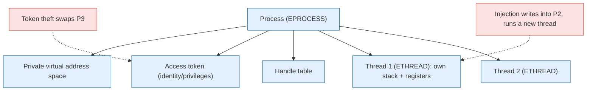

# Processes and Threads Internals

## Summary

A **process** on Windows is a container: a private virtual address space, an access token (its identity and privileges), a handle table, and one or more threads. A **thread** is the unit the scheduler actually runs — it has its own stack and CPU-register context but shares the process's memory and handles. The kernel represents each with structures (`EPROCESS`, `ETHREAD`, with the user-visible `PEB` and `TEB`) that hold the state attackers care about. Understanding this model explains code injection (writing into another process's address space and running a thread there), token theft (stealing the token a process carries), and why isolation between processes is a security boundary worth protecting.

## The key structures

| Structure | Holds |
|---|---|
| **EPROCESS** (kernel) | Process object: token pointer, handle table, VAD tree, links to threads |
| **ETHREAD** (kernel) | Thread object: start address, owning process, scheduling state |
| **PEB** (user) | Process Environment Block: loaded modules, image base, parameters |
| **TEB** (user) | Thread Environment Block: last-error, TLS, stack bounds |
| **Access token** | The identity/privileges the process runs with |

Processes share nothing by default — separate address spaces — which is the isolation attackers try to defeat with injection, and the token is the credential attackers try to steal or swap (covered under token abuse).

## Process/thread model

## Security relevance

- **Process isolation** (separate address spaces) is a boundary; code injection exists to cross it.
- The **access token** per process is the identity that access checks use; stealing or duplicating it impersonates another user (token abuse).
- **Parent/child relationships** and command lines are prime detection signals (e.g. Office spawning PowerShell).
- **Protected Process Light (PPL)** hardens sensitive processes (like LSASS) against tampering by other processes.

## Defense

- **Protect sensitive processes** with PPL and Credential Guard (notably LSASS).
- **Monitor process ancestry, command lines and creation events** (4688 / Sysmon 1) for anomalies.
- **Detect cross-process memory operations** (remote allocation, write, and thread creation) that indicate injection.
- **Least privilege** so attackers cannot easily open privileged processes for token theft.

## ATT&CK mapping

No single ATT&CK technique; this underpins process injection, access token manipulation and credential-access techniques documented in their own files.

## Explanation

A process is like a rented workshop: it has its own locked room (memory), an ID badge on the wall (the token saying who rents it and what they may do), a keyring (handles to files and other resources), and workers inside (threads) who actually do the work, each at their own bench but sharing the room. The walls between workshops are the point — your tools and papers stay yours. Attacks on this model are attempts to defeat the walls (sneak your own worker and tools into someone else's workshop) or to swap the badge on the wall so the room's work is done under a more powerful identity. Defenders reinforce the walls around the most valuable workshops and watch for workers appearing where they shouldn't.
