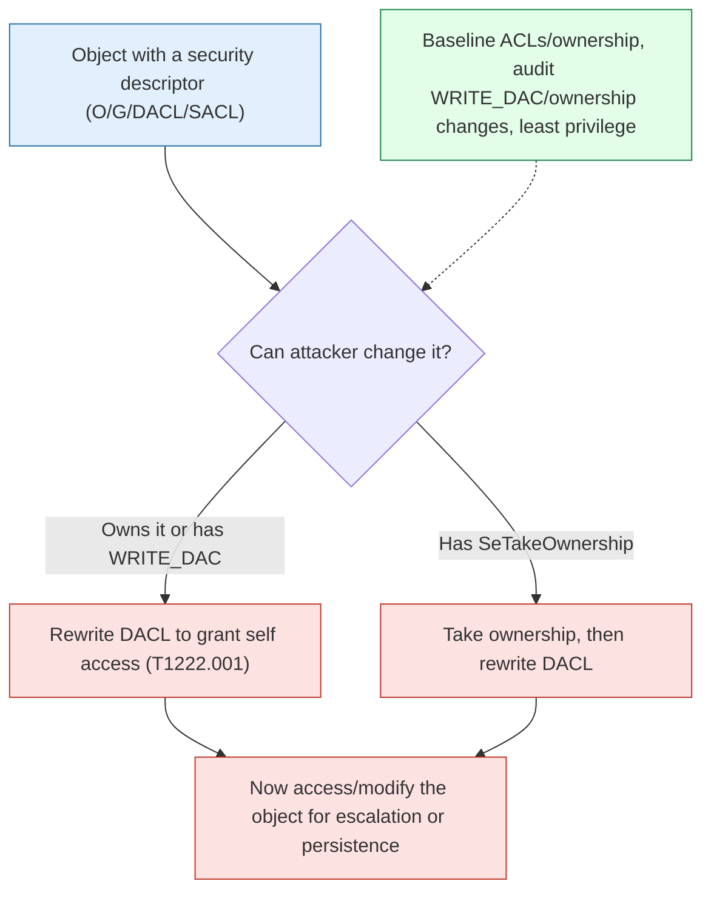

# Security Descriptors and SDDL

## Summary

A **security descriptor** is the structure that carries an object's security information: its owner, its DACL (the discretionary access control list that decides who may access it), its SACL (the system access control list that decides what is audited), and control flags. The **Security Descriptor Definition Language (SDDL)** is a compact text format for reading and writing them, used by tools and scripts (for example, `D:(A;;FA;;;BA)` means "allow Built-in Administrators full access"). Attackers weaken security descriptors to grant themselves access or to open an object up for later abuse, and they tamper with ownership/DACLs to persist or escalate (file and directory permissions modification: Windows file and directory permissions modification, T1222.001). Reading SDDL fluently is how defenders audit whether permissions are actually safe.

## Anatomy

| Part | Meaning |
|---|---|
| **Owner (O:)** | The SID that owns the object; can always change its DACL |
| **Group (G:)** | Primary group (legacy/POSIX relevance) |
| **DACL (D:)** | Ordered ACEs granting/denying rights to SIDs |
| **SACL (S:)** | Audit ACEs defining what access is logged |
| **ACE** | e.g. `(A;;FA;;;BA)` = Allow; Full Access; to Built-in Admins |

Key SDDL shorthands: `A`=allow, `D`=deny; rights like `FA` (full), `FR`/`FW`/`FX` (read/write/execute); well-known SIDs like `BA` (admins), `SY` (SYSTEM), `WD` (Everyone), `AU` (Authenticated Users). A DACL granting `WD` or `AU` write to a sensitive object is a classic misconfiguration.

## Permission tampering flow

## Detection

- Changes to DACLs or ownership on sensitive objects (files, registry keys, services, directories), especially granting Everyone/Authenticated Users access.
- Use of ownership-taking or DACL-writing privileges (SeTakeOwnership, WRITE_DAC) outside administrative change windows.
- `icacls`/PowerShell ACL-modification commands run by unexpected processes.
- SACL audit events for permission changes on monitored objects.

## Defense

- **Baseline security descriptors** on critical objects and alert on DACL/owner changes.
- **Least privilege**: avoid granting broad SIDs (Everyone, Authenticated Users) write access.
- **Audit dangerous privileges** (SeTakeOwnership, SeRestore) and the WRITE_DAC right.
- **Enable SACL auditing** on sensitive objects so permission changes are logged.
- **Read SDDL carefully** in reviews — a single overly-broad ACE can undo other controls.

## ATT&CK mapping

| ID | Name | Tactic |
|---|---|---|
| T1222.001 | File and Directory Permissions Modification: Windows Permissions | Defense Impairment |

## Explanation

If the ACL is the guest list on a door, the security descriptor is the whole clipboard it hangs on: who owns the door, the guest list itself, and a separate sheet noting which entries to write down in the logbook (auditing). SDDL is just the shorthand that clipboard is written in, so `(A;;FA;;;BA)` reads as "allow administrators everything." The attack is simple to state: if you can edit the clipboard — because you own the door or hold a master pass — you add your own name to the guest list and walk in. Defenders learn to read the shorthand fluently, keep a photo of what each important clipboard *should* say, and get alerted the moment someone rewrites one, especially if the new entry says "everyone welcome."
