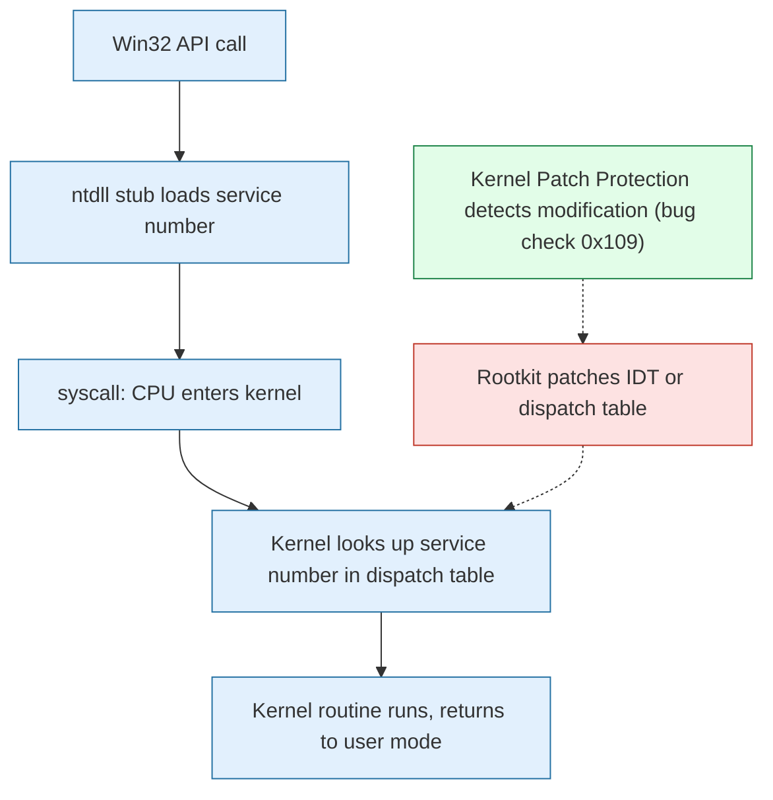

# Windows Trap, Interrupt, Exception and System Service Dispatching

## Summary

A **trap** is the processor's way of stopping what it is doing and handing control to the kernel. Windows uses one family of mechanisms for three very different events: **interrupts** from hardware (a disk finished, a timer fired), **exceptions** raised by the running code (divide by zero, access violation, breakpoint), and **system service calls**, where user-mode code deliberately asks the kernel to do something. The kernel saves the interrupted state, works out what kind of event happened, and sends it to the right handler. These entry points are exactly where rootkits historically hooked to hide activity and where security products want visibility, which is why Windows now protects them with Kernel Patch Protection.

## Key ideas

| Event | Source | What the kernel does |
|---|---|---|
| **Hardware interrupt** | A device, line-based or message-signalled (MSI/MSI-X) | Raises IRQL to the device's level, runs the driver's interrupt service routine, queues a DPC for the rest |
| **Exception** | The executing instruction | Builds an exception record and searches for a handler (debugger, vectored, then frame-based) |
| **System service call** | User code executing a syscall instruction via `ntdll.dll` | Looks up the service number and calls the matching kernel routine |
| **IRQL** | Kernel priority level per CPU | Masks lower-priority interrupts while higher-priority work runs |

## How it works

### Interrupts

Devices signal either over a dedicated line or, for PCI 2.2 and later devices, by writing a message to a memory address (message-signalled interrupts). The processor looks up the interrupt vector in its interrupt descriptor table (IDT) and enters the kernel. Windows raises the processor's IRQL to the device's level (DIRQL) so that equal and lower-priority interrupts are masked, runs the driver's interrupt service routine briefly, and defers the remaining work to a DPC at DISPATCH_LEVEL. Timer interrupts drive the clock, thread quantum accounting and timer expiry.

### Exceptions

When an instruction faults, the kernel captures the processor state and dispatches the exception. A user-mode exception goes first to an attached debugger (first chance), then to any **vectored exception handlers** the process registered (these are not tied to a stack frame), then to **frame-based structured exception handlers** found by walking the stack. If nothing handles it, the debugger gets a second chance and then Windows Error Reporting takes over and the process ends.

### System service calls

A Win32 API such as `CreateFile` ends up in a stub in `ntdll.dll` that loads a service number and executes the processor's system call instruction. The kernel switches to the thread's kernel stack, uses the number to index the system service dispatch table, validates and copies arguments from user memory, and calls the kernel routine. On return it drops back to user mode.

## Security relevance

- **Kernel hooking.** Older rootkits replaced entries in the IDT or the system service table so every call passed through them first (T1014). On 64-bit Windows, Kernel Patch Protection checks these structures and crashes the system with bug check 0x109 (CRITICAL_STRUCTURE_CORRUPTION) when it finds a change; the bug check's parameters list IDT and GDT modification among the detected corruption types.
- **Direct system calls.** Because user-mode `ntdll` stubs are just a service number plus a syscall instruction, malware can issue the instruction itself to skip user-mode EDR hooks (T1106; see Direct Syscalls and EDR Bypass).
- **Exception handlers as control flow.** Malware abuses vectored and structured handlers for anti-debugging and for redirecting execution after a deliberate fault.

## Detection and defence

- Keep Kernel Patch Protection, HVCI and driver signature enforcement enabled so kernel tables cannot be quietly patched.
- Prefer kernel telemetry (ETW, kernel callbacks) over user-mode hooks; it still sees a call made with a direct syscall.
- Investigate bug checks 0x109 on production machines: they can indicate kernel tampering as well as buggy drivers.

## ATT&CK mapping

- **T1014 Rootkit**: kernel table hooking.
- **T1106 Native API**: invoking system services directly.

## Explanation

Picture a switchboard at the front of the kernel. Every call comes in through it: urgent alarms from hardware, complaints that something just went wrong, and ordinary requests from programs. The operator notes what was happening, looks the caller up in a directory, and patches the call through to the right desk. A rootkit that rewrites that directory can listen to, or drop, any call it likes. Modern Windows posts a guard who periodically checks the directory against the original and shuts the whole building down if anyone has edited it.
