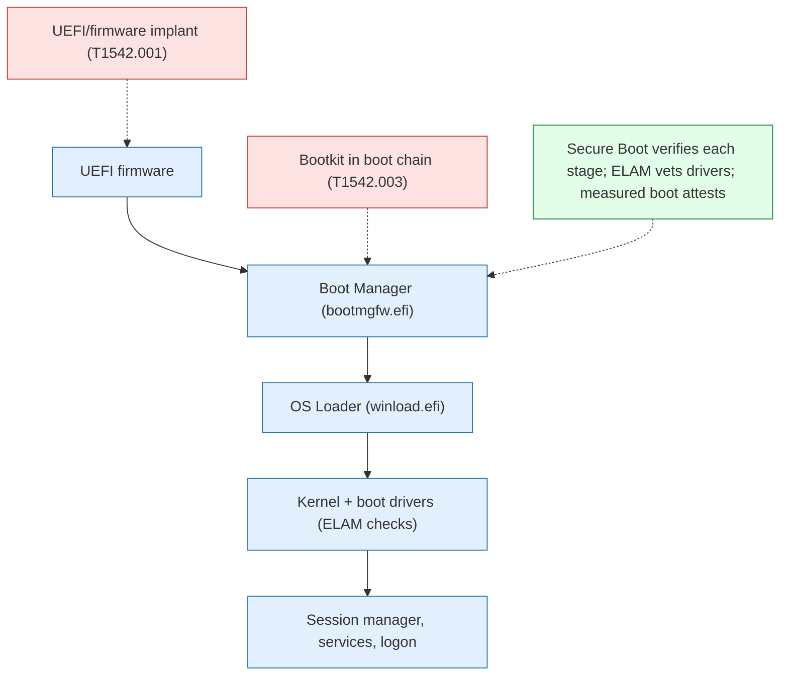

# Windows Boot Process

## Summary

The Windows boot process is a chain of handoffs: firmware (UEFI) runs first, verifies and launches the Windows Boot Manager, which loads the OS loader, which loads the kernel and boot drivers, which finally start user-mode subsystems and services. Each stage trusts and launches the next, so if an attacker subverts an early stage they control everything above it — which is exactly what bootkits (pre-boot persistence in the boot chain, T1542.003) and firmware/UEFI implants (T1542.001) do. Secure Boot and measured/verified boot exist to make each handoff prove the next component's integrity, so understanding the chain explains both the threat and the defence.

## The boot chain

| Stage | What happens |
|---|---|
| **UEFI firmware** | Initialises hardware; with Secure Boot, verifies the boot manager's signature |
| **Windows Boot Manager** (`bootmgfw.efi`) | Selects the OS and loads the Windows OS loader |
| **Windows OS Loader** (`winload.efi`) | Loads the kernel, HAL, and boot-start drivers |
| **Kernel init** | `ntoskrnl` initialises the Executive; ELAM evaluates boot drivers |
| **Session/user mode** | Smss, services, logon — the system becomes usable |

The earlier the stage, the more powerful the compromise: owning the firmware or boot manager means loading before, and hiding from, the OS and its security tools.

## Boot chain and attack points

## Detection

- Secure Boot disabled, or unexpected changes to boot configuration (BCD) and boot components.
- Measured-boot / TPM attestation anomalies (boot measurements not matching known-good).
- Unsigned or unexpected boot-start drivers, or ELAM reporting bad/unknown drivers.
- Firmware integrity tooling flagging modified UEFI firmware.

## Defense

- **Enable Secure Boot** so firmware verifies the boot manager and loader signatures.
- **Use measured boot with a TPM and remote attestation** to detect pre-OS tampering.
- **Keep firmware updated** and use vendor firmware-protection features; restrict physical/admin access that enables implants.
- **ELAM and HVCI** to vet drivers and protect kernel integrity.
- **Monitor BCD and boot-component changes** as high-severity events.

## ATT&CK mapping

| ID | Name | Tactic |
|---|---|---|
| T1542.003 | Pre-OS Boot: Bootkit | Persistence, Stealth |
| T1542.001 | Pre-OS Boot: System Firmware | Persistence, Stealth |

## Explanation

Starting Windows is a relay race of trust: the firmware runs first and hands the baton to the boot manager, which hands it to the loader, which hands it to the kernel, which finally lets your desktop appear. Each runner trusts whoever hands them the baton. The danger is that whoever runs *earliest* is effectively in charge of everyone after them, so an attacker who corrupts the firmware or the boot manager loads before Windows and its antivirus even wake up, and can hide from them completely. The defence is to make every handoff a signature check: Secure Boot refuses a tampered next runner, and measured boot keeps a tamper-evident log of exactly who ran, so a swapped runner is caught.
