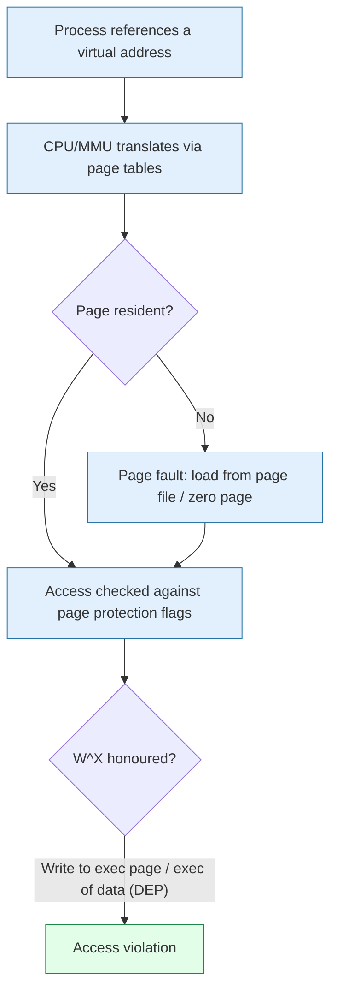

# Windows Memory Management (Virtual Memory and Paging)

## Summary

Windows gives every process its own **virtual address space**, a private map of addresses that the memory manager and CPU translate to physical RAM (or to the page file on disk) one page at a time. A process never sees physical memory directly; it sees its own virtual view, which both isolates processes from one another and lets the OS over-commit RAM by paging. Each page carries **protection flags** (readable, writable, executable) that the hardware enforces. These flags are central to exploitation and defence: writable-and-executable memory is what shellcode wants, and mitigations like DEP exist precisely to deny it. Knowing how virtual memory and page protections work explains both memory-corruption exploits and the protections that blunt them.

## Core concepts

| Concept | Meaning |
|---|---|
| **Virtual address space** | Per-process private address map; isolates processes |
| **Pages** | Fixed-size units (typically 4 KB) of translation and protection |
| **Page protections** | PAGE_READONLY, PAGE_READWRITE, PAGE_EXECUTE, PAGE_EXECUTE_READWRITE, etc. |
| **Paging / page file** | Inactive pages moved to disk to free RAM; faulted back on access |
| **Working set** | The pages of a process currently resident in RAM |

The dangerous combination for defenders is **PAGE_EXECUTE_READWRITE (RWX)**: memory both writable and executable, the natural home of injected code — so its presence is a strong detection signal.

## Address translation and protection

## Security relevance

- **Isolation**: separate virtual address spaces keep one process from reading another's memory without going through the kernel.
- **W^X / DEP**: marking data pages non-executable stops classic "write shellcode to the stack and jump to it" attacks, pushing attackers to code-reuse (ROP).
- **RWX memory** and newly allocated executable regions are high-value injection and shellcode indicators.
- **ASLR** randomises where modules and allocations land, making exploit addresses unpredictable (covered in exploit-mitigations).

## Defense

- **Enforce DEP/NX** so data pages cannot execute, and prefer code that never needs RWX.
- **Enable ASLR (and high-entropy ASLR)** broadly, including mandatory ASLR via Exploit Protection.
- **Monitor for RWX allocations and executable memory with no backing file** (manual mapping / injection).
- **Credential Guard / VBS** to protect sensitive secrets even from kernel-level memory access.
- Keep exploit mitigations (CFG, CET where available) enabled to harden control flow.

## ATT&CK mapping

No single ATT&CK technique; this is the substrate for process injection and memory-corruption exploitation described in their own files.

## Explanation

Every program is handed its own private floor plan of the building and told "these are your rooms," even though behind the scenes the caretaker (the memory manager) is constantly shuffling which real rooms those labels point to, and storing unused furniture in the basement (the page file) to save space. Each room also has a posted rule: read-only, read-write, or "work may be done here" (executable). A huge amount of attack and defence comes down to that last rule. Attackers want a room that is both writable and runnable so they can scribble instructions and then carry them out; defenders insist that no room is both at once (data can't run, code can't be rewritten), which forces attackers into far more awkward techniques.
