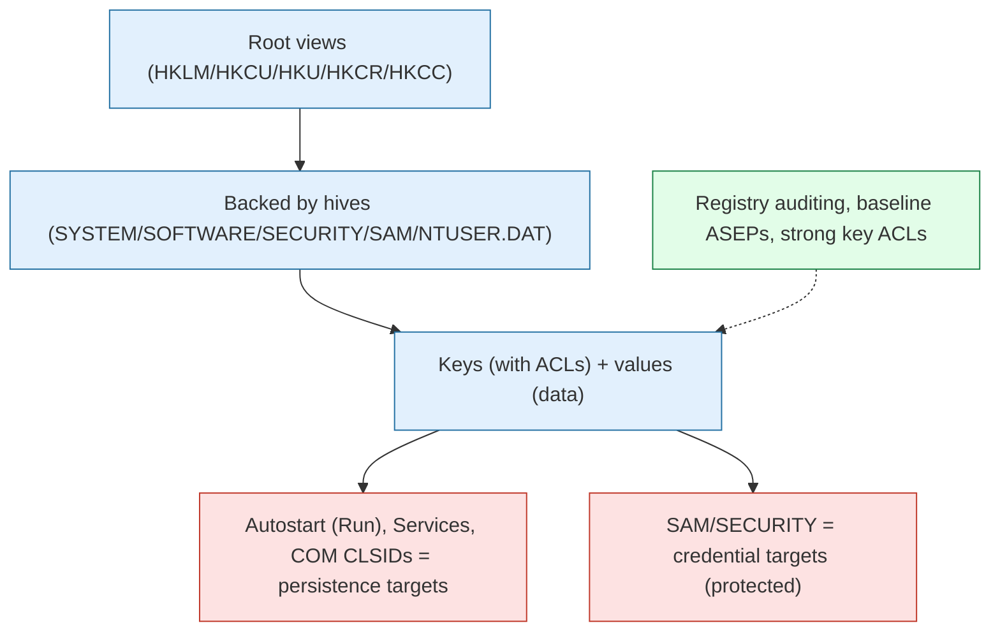

# Windows Registry Internals (Hives and Structure)

## Summary

The Windows registry is a hierarchical configuration database of **keys** (containers) and **values** (data), physically stored in files called **hives**. The familiar root keys (`HKLM`, `HKCU`, `HKU`, `HKCR`, `HKCC`) are mostly views mapped onto a smaller set of real hives on disk (SYSTEM, SOFTWARE, SECURITY, SAM, and per-user `NTUSER.DAT`). The registry is security-critical because so much behaviour is driven from it: autostart entries, service definitions, COM registrations, security policy, and credential material all live here. That is why it is simultaneously a favourite location for persistence and configuration tampering and a rich source of forensic evidence. Knowing which hive holds what, and that each key has its own ACL, explains both the attacks and the monitoring.

## Hives and roots

| Hive (on disk) | Mapped view / contents |
|---|---|
| **SYSTEM** | `HKLM\SYSTEM` — services, drivers, control sets, mounted devices |
| **SOFTWARE** | `HKLM\SOFTWARE` — installed software, autostart, policies |
| **SECURITY** | `HKLM\SECURITY` — local security policy, LSA secrets (protected) |
| **SAM** | `HKLM\SAM` — local account password hashes (protected) |
| **NTUSER.DAT** | `HKCU` / `HKU\<SID>` — per-user settings, user autostart (Run keys) |

Each key carries a security descriptor, so registry access is governed by the same access-check model as files; `HKCU` is user-writable (no admin), which is why so many no-privilege persistence tricks target it.

## Structure and security touchpoints

## Security relevance

- **Persistence**: Run keys, Services, COM CLSIDs, Winlogon values all live in the registry (own files cover these).
- **Credentials**: the SAM and SECURITY hives hold local hashes and LSA secrets (own file covers extraction, T1003.002).
- **Configuration tampering**: disabling security features or changing policy often means editing a value.
- **Forensics**: registry timestamps, MRU lists, and keys are a core evidence source; hives can be collected offline.

## Defense

- **Audit writes** to high-value keys (autostart, services, COM, policy) with registry auditing / Sysmon.
- **Baseline autostart extensibility points** and alert on new entries.
- **Strong ACLs** on sensitive keys; protect SAM/SECURITY (and enable Credential Guard for secrets).
- **Restrict remote registry** access.
- **Monitor** for bulk registry reads/exports that may indicate credential or recon activity.

## ATT&CK mapping

No single ATT&CK technique; the registry is the substrate for autostart persistence (T1547.001), service creation (T1543.003), COM hijacking (T1546.015) and SAM/LSA credential access (T1003.002), each covered in its own file.

## Explanation

The registry is the machine's central filing cabinet: every drawer (key) can hold folders and slips of paper (values), and the whole cabinet is actually assembled from a handful of physical binders (hives) — one for the system, one for installed software, locked ones for passwords and secrets, and a personal binder for each user. Almost everything Windows does on startup it looks up in this cabinet, which is exactly why attackers slip notes into it ("run my program at logon") and why the locked binders holding passwords are such a prize. Each drawer even has its own lock (an ACL), so the defence mirrors the file world: lock the important drawers, keep a photograph of what the startup drawers should contain, and fit the cabinet with a logbook that records who opened what.
