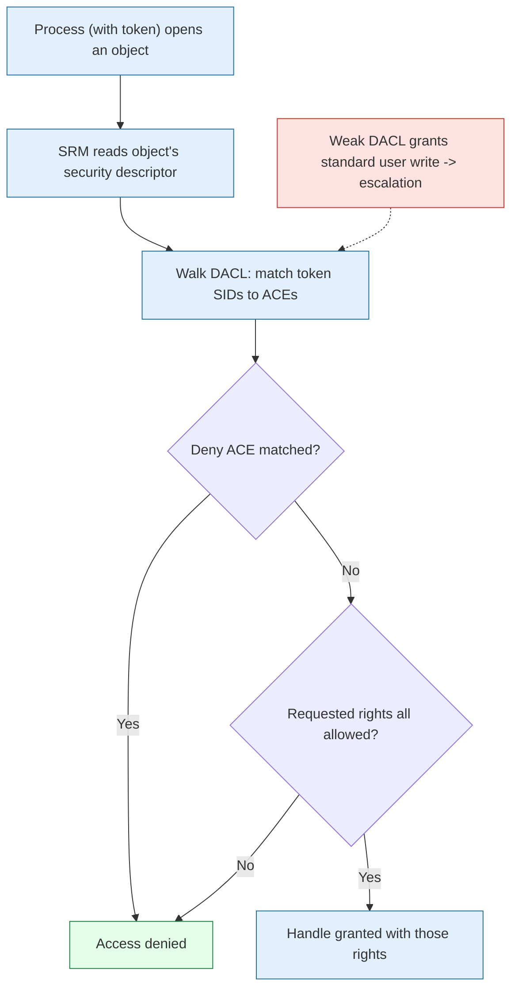

# Windows Security Model and Access Checks

## Summary

Windows decides who can do what by comparing an **access token** (the identity: user SID, group SIDs, and privileges carried by a process) against a resource's **security descriptor** (its owner and its access control list). When a process opens an object, the **Security Reference Monitor** performs an **access check**: it walks the object's DACL, matching the token's SIDs against the allow/deny entries, and grants exactly the rights permitted. This single mechanism governs files, registry keys, processes, services, and every other securable object. Understanding it is the key to privilege escalation (most misconfigurations are an ACL that grants a standard user more than it should) and to defence (correct ACLs and least privilege).

## The building blocks

| Element | Role |
|---|---|
| **Access token** | Identity + privileges of a process/thread: user SID, group SIDs, privilege list, integrity level |
| **Security descriptor** | Owner SID, group, DACL (who may access), SACL (what to audit) |
| **DACL / ACE** | List of access control entries granting or denying specific rights to SIDs |
| **Security Reference Monitor** | Kernel component that performs the access check |
| **Privileges** | Account-wide powers (e.g. SeDebug, SeImpersonate) separate from object DACLs |
| **Integrity levels** | Low/Medium/High/System labels that add a mandatory check |

Two things grant power: **DACL entries** (per-object rights) and **privileges** (account-wide abilities). Escalation abuses either — a writable object's DACL, or a dangerous privilege held by an account that shouldn't have it.

## Access check flow

## Security relevance

- **Most Windows privilege escalation is an ACL problem**: an object a standard user can modify that something privileged relies on (service binary, registry key, scheduled task).
- **Dangerous privileges** (SeDebug, SeImpersonate, SeBackup, SeRestore, SeTakeOwnership) can bypass or subvert normal checks — audit who holds them.
- **Integrity levels** add UAC's layer: a Medium-integrity process cannot write a High-integrity object even if the DACL would allow it.
- Access is decided **at open time** and the granted rights are then fixed in the handle.

## Defense

- **Correct, least-privilege ACLs** on services, registry, scheduled tasks, and program files.
- **Audit and trim privileges**: remove SeDebug/SeImpersonate and similar from accounts that don't need them.
- **Enable SACL auditing** on sensitive objects to log access attempts.
- **Preserve integrity-level boundaries**: run daily work at Medium, keep UAC at Always Notify.
- **Enumerate regularly** for writable-by-user objects that privileged components depend on.

## ATT&CK mapping

No single ATT&CK technique; this model underlies the privilege-escalation, token-abuse, and permission-modification techniques documented in their own files.

## Explanation

Every time a Windows program tries to touch something, a gatekeeper (the Security Reference Monitor) runs a quick test: it looks at the badge the program is wearing (its token — who you are, which groups you're in, which special powers you hold) and at the guest list posted on the thing you want (its ACL), and grants only the specific actions the list allows your badge. That one test guards files, settings, other programs — everything. Which means almost every way to illegitimately gain power is really one of two bugs: a guest list that mistakenly lets ordinary badges write something important, or a badge that was handed a special power it should never have had. Defenders win by keeping the guest lists tight and the special powers rare.
