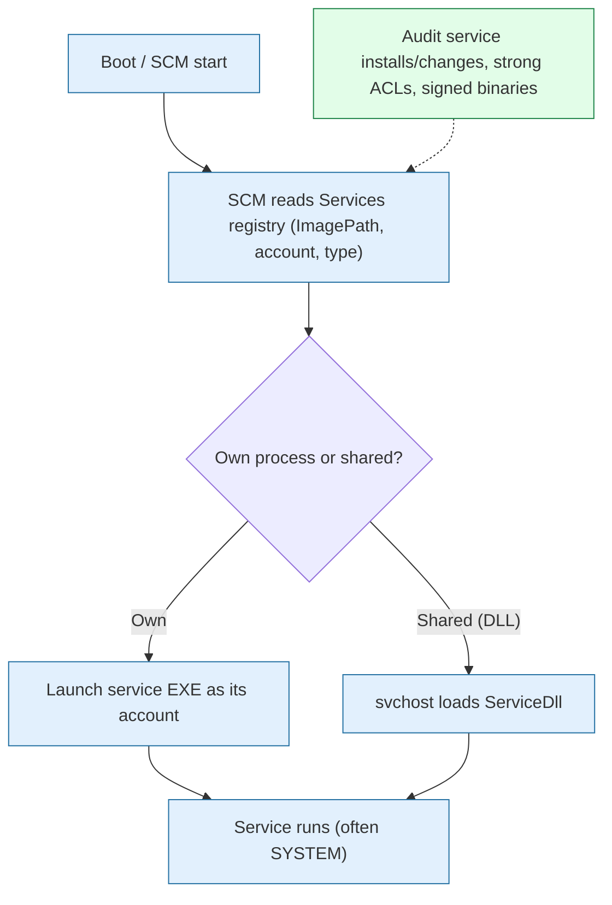

# Windows Services Architecture (SCM and svchost)

## Summary

Windows **services** are background programs managed by the **Service Control Manager (SCM)**, which starts, stops, and configures them according to definitions in `HKLM\SYSTEM\CurrentControlSet\Services`. Services can start automatically at boot, run without any user logged on, and commonly run as powerful accounts such as SYSTEM, LocalService, or NetworkService. Many lightweight services do not get their own process; they run as DLLs hosted inside shared **svchost.exe** processes grouped by function. This architecture is central to security because "runs as SYSTEM at boot" is exactly what both the OS and attackers want — hence services are a prime target for persistence and privilege escalation (detailed in the service-persistence and weak-service-permissions files).

## Core elements

| Element | Role |
|---|---|
| **SCM** (`services.exe`) | Starts/stops/configures services; reads the Services registry |
| **Service registry keys** | Define `ImagePath`, start type, account, dependencies, and `ServiceDll` |
| **svchost.exe** | Host process for DLL-based services, grouped by service-group |
| **Service accounts** | SYSTEM, LocalService, NetworkService, managed/virtual accounts |
| **Recovery actions** | Commands/restarts run if a service fails |

The `ServiceDll` (under the service's `Parameters` key) is especially security-relevant: a svchost-hosted service loads that DLL, so controlling it runs code inside a trusted host.

## Service startup

## Security relevance

- Services often run as **SYSTEM and start at boot**, making them ideal for persistence and escalation when misconfigured.
- **Weak ACLs** on service binaries, registry keys, or reconfiguration rights let standard users hijack what a service runs.
- **svchost + ServiceDll** lets malicious code run inside a trusted process, aiding evasion.
- Service installation and configuration changes are **loggable chokepoints** for detection.

## Defense

- **Tighten ACLs** on service binaries, directories, and Services registry keys; remove unneeded reconfiguration rights.
- **Use least-privileged/managed service accounts** instead of SYSTEM where possible.
- **Audit service installs and changes** (4697/7045/7040) and baseline the service inventory.
- **Signed service binaries and application control** so a service cannot run unapproved code.

## ATT&CK mapping

No single ATT&CK technique here; service-based persistence and escalation are mapped in the Windows Service persistence (T1543.003) and weak-service-permissions (T1574.010) files.

## Explanation

Services are the night shift of a Windows machine: programs that clock in by themselves when the computer starts, keep working whether or not anyone is logged in, and usually carry the highest-level keys (SYSTEM). The Service Control Manager is the shift supervisor who reads a roster in the registry to know who to start, which key they hold, and whether they get their own office or share a desk inside a svchost. For an attacker this night shift is gold: get a worker added, or quietly swap the duties of an existing one, and you have a top-privilege presence that shows up after every reboot. So defenders keep the roster locked down and audited, so a new or altered night-shift worker gets noticed immediately.
