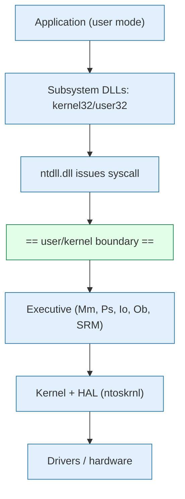

# Windows System Architecture (User Mode and Kernel Mode)

## Summary

Windows splits execution into two privilege levels enforced by the CPU: **user mode**, where applications run with restricted access and their own private address space, and **kernel mode**, where the operating system core and drivers run with full access to hardware and all memory. A user-mode process cannot touch hardware or another process's memory directly; it must ask the kernel through a controlled system-call boundary. This divide is the fundamental security boundary of the OS — crossing from user to kernel without authorisation is the goal of local privilege escalation and the reason kernel exploits are so powerful. Understanding which components live where explains why some attacks need only user rights and others require a kernel bug.

## The major components

| Layer | Runs in | Examples |
|---|---|---|
| **Applications & subsystems** | User mode | Your programs, Win32 subsystem, service host processes |
| **Subsystem DLLs / API** | User mode | `kernel32`, `user32`, `ntdll` (the gateway to system calls) |
| **Executive** | Kernel mode | Memory manager, process/thread manager, I/O manager, object manager, security reference monitor |
| **Kernel & HAL** | Kernel mode | Core scheduler/synchronisation (`ntoskrnl.exe`), Hardware Abstraction Layer |
| **Drivers** | Kernel mode | Device, filesystem, and filter drivers |

`ntdll.dll` is the last user-mode stop: it issues the actual system-call instruction that transitions into the kernel. Everything a program ultimately does to files, memory, or devices passes through that boundary.

## Architecture layers

## Security relevance

- The user/kernel boundary is *the* local security boundary: code in kernel mode can read/write all memory and bypass most protections.
- Most malware runs in user mode; reaching kernel mode (via a driver or kernel vulnerability) grants far deeper control, including hiding from user-mode defences.
- The system-call interface (`ntdll` → kernel) is a monitored chokepoint; direct syscalls are used to evade user-mode API hooks.
- The Security Reference Monitor in the Executive performs the access checks that enforce permissions.

## Defense

- **Keep the kernel attack surface small**: driver signing, Driver Signature Enforcement, and blocking known-vulnerable drivers.
- **Virtualization-based security (VBS/HVCI)** isolates critical kernel components so even a kernel bug has less reach.
- **Least privilege in user mode** so attackers cannot easily load drivers or reach kernel-exploit surfaces.
- **Monitor** driver loads and anomalous system-call patterns.
- Patch promptly: kernel and driver bugs are the route across the boundary.

## ATT&CK mapping

No single ATT&CK technique; this is foundational context for kernel-level techniques (e.g. exploitation for privilege escalation, rootkits, and driver abuse covered elsewhere).

## Explanation

Think of Windows as a building with a public floor and a secure control room. On the public floor (user mode) anyone can walk around their own office, but the doors to the wiring, the vault, and everyone else's office are locked. To do anything real — read a file, draw on the screen, talk to a device — you slip a request form through a single guarded hatch (the system call), and staff in the control room (kernel mode) carry it out on your behalf. The control room can touch everything; the public floor can touch almost nothing without asking. That is why the whole game of local attacks is about getting from the public floor into the control room, and why the defenders guard that one hatch and the few ways (drivers, bugs) of sneaking past it so carefully.
