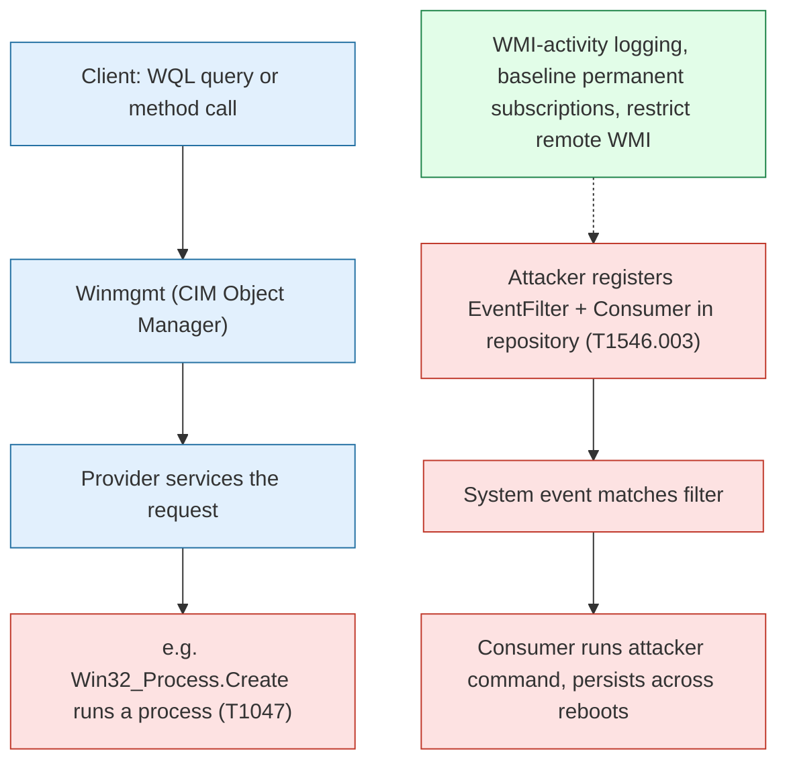

# WMI Architecture (Windows Management Instrumentation)

## Summary

Windows Management Instrumentation (WMI) is Windows's built-in management framework: a standardised way to query and control the system — processes, services, hardware, event logs, configuration — through classes exposed by providers and stored in the **CIM repository**. Because WMI is powerful, present everywhere, remotely accessible, and considered legitimate administrative tooling, attackers use it to execute code, move laterally, gather information, and persist (Windows Management Instrumentation, T1047; WMI event-subscription persistence, T1546.003). Understanding its architecture — the service (`Winmgmt`), providers, the repository, and the event subsystem — explains both why WMI is so useful to administrators and why its abuse is hard to distinguish from normal activity.

## Architecture pieces

| Component | Role |
|---|---|
| **WMI service (`Winmgmt`)** | The CIM Object Manager that brokers queries between clients and providers |
| **Providers** | DLLs that surface specific data/actions as WMI classes |
| **CIM repository** | Stores class definitions and persistent data (e.g. event subscriptions) |
| **Consumers/clients** | Scripts/tools querying via WQL or calling methods (e.g. `Win32_Process.Create`) |
| **Event subsystem** | Filters + consumers that trigger actions on system events (abused for persistence) |

The event subsystem is the persistence engine: an `__EventFilter` (a condition) bound to a `CommandLineEventConsumer` (an action) runs attacker code whenever the condition fires — all stored in the repository, surviving reboots.

## WMI execution and persistence

## Detection

- WMI process creation (`Win32_Process.Create`) and the resulting process ancestry (WmiPrvSE spawning shells).
- Permanent WMI event subscriptions: new `__EventFilter`, `CommandLineEventConsumer`/`ActiveScriptEventConsumer`, and `__FilterToConsumerBinding` objects.
- WMI-Activity operational log entries, and remote WMI/DCOM/WinRM connections for lateral movement.
- Repository changes outside management tooling.

## Defense

- **Enable WMI-Activity logging** and baseline/monitor permanent event subscriptions.
- **Restrict remote WMI** (firewall, DCOM/WinRM hardening) to limit lateral movement.
- **Least privilege**: limit who can create WMI subscriptions and execute methods.
- **Application control** so WMI-launched payloads cannot run.
- **Audit the CIM repository** for unexpected persistent consumers.

## ATT&CK mapping

| ID | Name | Tactic |
|---|---|---|
| T1047 | Windows Management Instrumentation | Execution |
| T1546.003 | Event Triggered Execution: Windows Management Instrumentation Event Subscription | Privilege Escalation, Persistence |

## Explanation

WMI is the building's intercom-and-controls system: from one panel an administrator can ask any room's temperature, see who's inside, or tell a machine to switch on. It is meant for the facilities team, which is exactly why intruders love it — using it looks like routine maintenance. Worse, WMI has a built-in "if this happens, do that" automation (the event subsystem), so an attacker can wire up a rule like "whenever someone logs in, quietly run my program," store it in the building's control memory, and have it survive every reboot. Because the tool is legitimate, defence is less about blocking WMI and more about recording how it's used and spotting the one standing automation rule nobody authorised.
