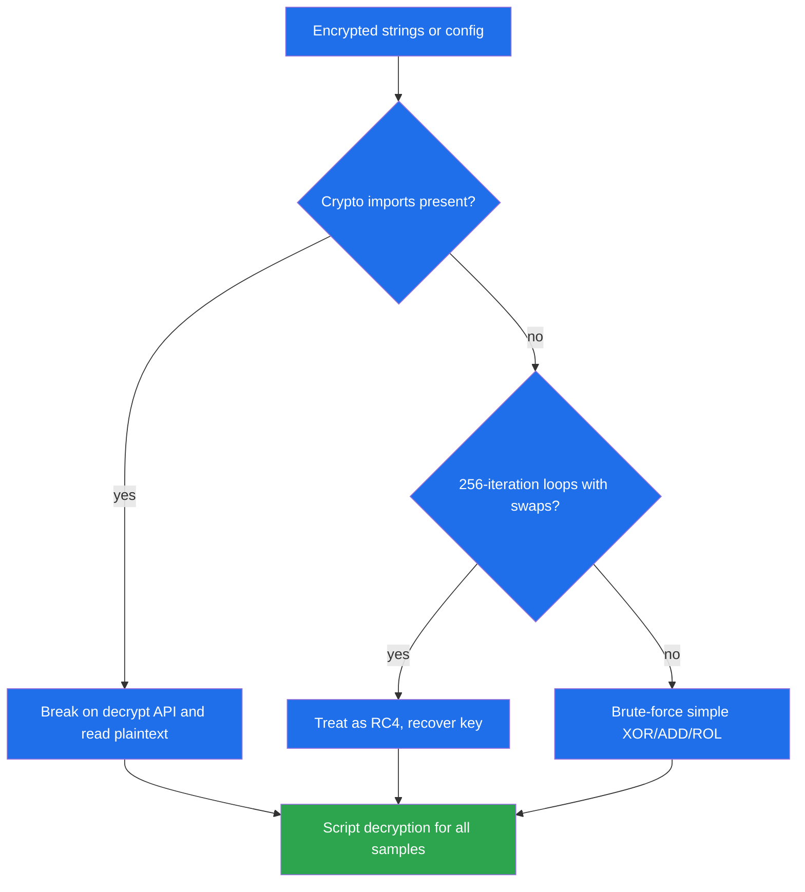

# Encryption Identification in Malware (RC4, CryptoAPI, X-Raying)

## Summary

Malware encrypts the things analysts most want to read: strings, API names, configuration (C2 addresses, campaign IDs) and network traffic (T1027, T1573.001). If you can recognise *which* algorithm is used and *where* the key comes from, you can decrypt that data statically, across every sample of the family, without running anything. Most malware uses one of three things: a home-made simple cipher (XOR, add, rotate), a small well-known cipher implemented inline (RC4 is the classic), or the Windows cryptography APIs.

## 1. Simple ciphers and "X-raying"

Single-byte XOR, ADD or ROL encodings are common for strings and embedded payloads. Because the key space is tiny, you can **brute-force** it over the whole file and look for known plaintext such as `This program cannot be run in DOS mode`, `http`, or `MZ`. This is sometimes called X-raying. Note that XOR with key `0x00` changes nothing, so exclude it from the search.

## 2. Recognising RC4 in disassembly

RC4 has a very recognisable shape. The Linux kernel's reference implementation shows it clearly:

| Phase | What it looks like in code |
|---|---|
| **Key scheduling** | A loop of exactly 256 iterations that fills a 256-byte array with 0..255 (`S[i] = i`), then a second 256-iteration loop that mixes the key into the array by swapping entries |
| **Keystream generation** | A loop over the data that updates two indices, swaps two entries of the array, and XORs a selected array byte into each data byte |

Two back-to-back loops with the constant 256 (`0x100`), followed by byte swaps and an XOR, is a strong RC4 signature. Find the function, find its key argument, and you can decrypt offline.

## 3. Windows cryptography APIs

When malware uses the OS, the imports tell you, and breakpoints on these functions reveal keys and plaintext in a debugger.

| API family | Typical call sequence | Notes |
|---|---|---|
| **CryptoAPI** (legacy) | `CryptAcquireContext` (get a provider handle) → `CryptImportKey` or `CryptDeriveKey` (prepare the key) → `CryptEncrypt` / `CryptDecrypt` → `CryptReleaseContext` | Microsoft marks CryptoAPI as deprecated in favour of CNG, but it is still everywhere in malware |
| **CNG** (Cryptography Next Generation) | `BCryptOpenAlgorithmProvider` → `BCryptGenerateSymmetricKey` → `BCryptEncrypt` / `BCryptDecrypt` | The modern API |

A breakpoint on `CryptDecrypt` or `BCryptDecrypt`, stopping on return, shows you the decrypted buffer directly (T1140).

## Automating it

Once the algorithm and key location are known, write a script (IDAPython, Ghidra scripting, or standalone Python) that finds every encrypted blob and decrypts it in place. The same approach resolves API names that are stored encrypted and looked up at run time.

## ATT&CK mapping

- **T1027 Obfuscated Files or Information**: encrypted strings and configuration.
- **T1140 Deobfuscate/Decode Files or Information**: the run-time decryption you reproduce.
- **T1573.001 Symmetric Cryptography**: encrypted C2 traffic.

## Explanation

Encrypted malware strings are a locked diary. You don't need to pick the lock if you can find where the owner keeps the key, and malware always keeps it somewhere in its own pockets, because it needs to read the diary too.
