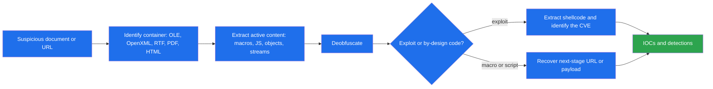

# Malicious Document and Web Exploit Analysis (JavaScript, PDF, Office)

## Summary

Many intrusions start with a file the victim opens (T1204.002) from a phishing email (T1566.001), or a web page they visit (T1189 Drive-by Compromise). The file or page carries either **active content** that runs by design (Office macros, JavaScript, DDE links) or an **exploit** for a bug in the reader or browser (T1203). In both cases the dangerous part is buried inside a container format and usually obfuscated. Analysis means taking the container apart safely, extracting the active part, and working out what it would do, ideally without ever opening the file in the vulnerable application.

## Office documents

Office files come in two container types: legacy OLE (Compound Binary Files, e.g. `.doc`, `.xls`) and OpenXML (zip-based, e.g. `.docx`, `.xlsm`).

| Tool | Use (per its documentation) |
|---|---|
| **oletools `oleid`** | Analyse OLE files for characteristics usually found in malicious files |
| **oletools `olevba`** | Extract and analyse VBA macro source from OLE and OpenXML documents |
| **oletools `msodde`** | Detect and extract DDE/DDEAUTO links from Office documents, RTF and CSV |
| **oletools `rtfobj`** | Extract embedded objects from RTF files |
| **Didier Stevens `oledump.py`** | Analyse OLE (Compound Binary) files stream by stream |

Typical flow: triage with `oleid`, dump macros with `olevba`, then deobfuscate the macro (see [Malicious Script Deobfuscation](malicious-script-deobfuscation.md)). If a document has no macros but still runs code, suspect an exploit or an embedded object.

## PDF documents

| Tool | Use |
|---|---|
| **`pdfid.py`** | Quick test of a PDF: counts keywords such as JavaScript, OpenAction and embedded files that indicate active content |
| **`pdf-parser.py`** | Parse the PDF, select objects, and decompress streams to extract embedded JavaScript or files |

Embedded JavaScript in a PDF is then analysed like web JavaScript. Some exploits only fire on a particular reader version, so analysts sometimes emulate the version check to make the script reveal its payload.

## Web exploits and JavaScript

Exploit kits deliver heavily obfuscated JavaScript that checks the browser and plug-ins, then serves a matching exploit. Analysis options:

- **Static deobfuscation** with tools such as JSDetox, a JavaScript malware analysis tool that combines static deobfuscation with an execution engine that emulates the HTML DOM.
- **Run in a standalone JavaScript engine** with the DOM objects the script expects stubbed out, printing instead of executing the final `eval`.
- **Network side**: extract the files transferred over HTTP from a packet capture, and map the chain of redirects from landing page to payload.

## Safety

Analyse on an isolated VM with no access to production networks. Prefer static tools; when you must open the file, use a snapshot you can revert.

## Defences this informs

- Block macros from internet-sourced files and keep readers and browsers patched.
- AMSI integrates with Office VBA, JavaScript and VBScript, so run-time macro and script content can be scanned after deobfuscation.
- Detect Office applications spawning script hosts or `powershell.exe`.

## ATT&CK mapping

- **T1566.001 Spearphishing Attachment**, **T1204.002 Malicious File**: delivery and user execution.
- **T1203 Exploitation for Client Execution**, **T1189 Drive-by Compromise**: exploit-based delivery.
- **T1059.007 JavaScript**: script-based stages.

## Explanation

A malicious document is a gift box with something nasty inside. You don't open it at the party (in Word or the browser); you X-ray it, cut it open in a blast chamber, and look at the contents piece by piece.
