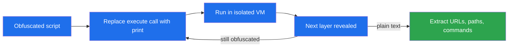

# Malicious Script Deobfuscation (VBS, PowerShell, JavaScript)

## Summary

The first stage of many intrusions is a script: a macro, a `.vbs` or `.js` attachment, or a PowerShell one-liner launched by one of those. Its job is small (download and run the next stage), but it is wrapped in layers of obfuscation (T1027.010 Command Obfuscation) to beat signatures and slow analysts down. Downloaders such as Emotet (ATT&CK S0367) made heavily obfuscated PowerShell a daily sight in SOCs. The analyst's goal is simple: peel the layers until the URL, file path or command is in plain text.

## Common obfuscation tricks

| Trick | Example shape |
|---|---|
| **Encoding** | Base64, hex, decimal char codes (`[char]72`, `Chr(72)`, `String.fromCharCode`) |
| **String splitting and concatenation** | `'Down'+'loadStr'+'ing'` |
| **Replace / reverse / format** | Junk characters removed with `-replace`; strings reversed; `-f` format operator reorders pieces |
| **Compression** | Deflate or GZip stream decompressed in memory before execution |
| **`-EncodedCommand`** | PowerShell accepts a Base64 command string; Microsoft's docs specify the string must be UTF-16LE before encoding |
| **Dynamic execution** | The final layer is passed to `Invoke-Expression`/`IEX`, `Execute`/`Eval` (VBScript), or `eval` (JavaScript) |
| **Noise** | Random variable and function names, dead code |

Daniel Bohannon's **Invoke-Obfuscation** is a public framework that produces many of these PowerShell forms; knowing its output styles helps you recognise them.

## Deobfuscation techniques

1. **Swap execute for print.** Replace the final `IEX`/`Invoke-Expression`, `Execute` or `eval` with an output call (`Write-Output`, `WScript.Echo`, `console.log`). Run it in an isolated VM; the script decodes itself and prints its next stage instead of running it. Repeat per layer.
2. **Decode by hand or in CyberChef.** GCHQ's CyberChef chains Base64, UTF-16LE decoding, decompression, XOR and more in a browser recipe.
3. **Use purpose-built tools.** **PSDecode** overrides functions such as `Invoke-Expression` to intercept and print what an encoded PowerShell script tries to run (its author warns to use it only in an isolated sandbox). **JSDetox** analyses and deobfuscates JavaScript.
4. **Rename as you go.** Give variables meaningful names once you know what they hold.

## Detection

- **PowerShell Script Block Logging** (event 4104) records the content of script blocks as PowerShell processes them, which includes code produced at run time by earlier layers.
- **AMSI** (Antimalware Scan Interface) lets antimalware products scan content at run time; Microsoft lists PowerShell (scripts, interactive use and dynamic code evaluation), JavaScript and VBScript, and Office VBA macros among the integrated components, so the scanner sees code after earlier layers have decoded it. See [Antimalware Scan Interface (AMSI)](../defense-evasion/antimalware-scan-interface-amsi.md).
- Hunt for `-EncodedCommand` (and its abbreviations), `IEX`, `FromBase64String` and decompression classes on the command line.

## ATT&CK mapping

- **T1027.010 Command Obfuscation**
- **T1140 Deobfuscate/Decode Files or Information**
- **T1059.001 PowerShell**, **T1059.005 Visual Basic**, **T1059.007 JavaScript**

See also [PowerShell Obfuscation and Logging Bypass](../defense-evasion/powershell-obfuscation-and-logging-bypass.md).

## Explanation

An obfuscated script is a set of nested envelopes, each saying "open the next one and do what it says". Instead of obeying, you swap the last instruction for "read it aloud", and the script reads you its own secret.
