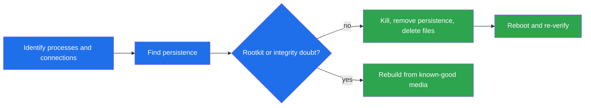

# Malware Identification and Manual Removal Procedures

## Summary

Layered defences (firewalls, IDS/IPS, mail and web gateways, endpoint protection) will still miss some infections. Responders need a repeatable manual procedure to **identify** what is running, **remove** it including its persistence, and **decide** when cleaning is not good enough and the machine must be rebuilt. Start with tools built into Windows, then bring in trusted external tools.

## Step 1: identify with built-in tools

| Question | Built-in command |
|---|---|
| What is running, and which services live in which process? | `tasklist /v`, `tasklist /svc` |
| What is talking to the network, and which process owns it? | `netstat -ano` (then match the PID in `tasklist`) |
| Which modules does a process load? | `tasklist /m` |
| Richer process and system queries | PowerShell `Get-CimInstance` (e.g. `Win32_Process` with command lines) |

Note on WMIC: Microsoft states the WMIC command-line utility is deprecated as of Windows 10 21H1 and superseded by PowerShell for WMI. Older playbooks use `wmic process get ...`; prefer PowerShell CIM cmdlets today.

## Step 2: find persistence

Killing a process is not removal. Malware survives reboots via auto-start locations:

| Mechanism | ATT&CK |
|---|---|
| Registry Run keys and Startup folder | T1547.001 |
| Services | T1543.003 |
| Scheduled tasks | T1053.005 |
| Watchdog pairs (two processes that restart each other) | Kill both, or suspend them first |

Sysinternals **Autoruns** shows the programs configured to start automatically at boot and logon across these locations, and is the fastest way to review them. Compare against a known-good baseline from the same build.

## Step 3: remove

1. Disconnect the host from the network (or isolate it with EDR).
2. Suspend or terminate the malicious processes (`taskkill /pid <PID> /f`; watchdogs together).
3. Remove each persistence entry, then the files.
4. Reboot and **verify** nothing returns: re-run the identification steps.
5. Record every change.

## When to rebuild instead

A rootkit (T1014) can hide processes, files and registry keys from the very tools you are using, so a clean-looking result proves little. If there is any sign of a kernel-level component, or you cannot establish the system's integrity, **rebuild** from known-good media and restore data from backups. Check from an independent view (offline scan from boot media, memory analysis) when in doubt.

## Practical rules

- Identify before you remove; preserve evidence (memory image, sample) first if an investigation may follow.
- Distrust output on a possibly rooted host.
- Prefer rebuild when the cost of being wrong is high.

## ATT&CK mapping

- **T1547.001**, **T1543.003**, **T1053.005**: common persistence to remove.
- **T1014 Rootkit**: the reason manual cleaning can fail.

See also [Live Response and Triage Collection](../forensics/live-response-and-triage-collection.md).

## Explanation

Removing malware by killing its process is like pulling a weed at the stem: it grows back from the roots (persistence). Manual removal means digging out the roots too. And if the weed has spread under the foundations (a rootkit), you stop weeding and replant the garden.
