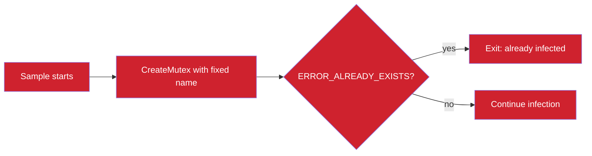

# Mutexes as Malware Infection Markers

## Summary

A mutex (mutual exclusion object; "mutant" inside the Windows kernel) is a lock that only one thread can hold at a time. A **named** mutex can be shared across processes, which makes it a convenient way for malware to answer the question "am I already running on this machine?". Running twice would waste resources, corrupt shared files or double the network noise, so many families create a hard-coded mutex name at start-up and exit if it already exists. ATT&CK tracks this as **T1480.002 Mutual Exclusion**. For defenders, that fixed name is a reliable, cheap host indicator.

## How malware uses it

Two common patterns:

1. **Open, then create**: call `OpenMutex` with the fixed name. If it succeeds, another copy is running, so exit. Otherwise call `CreateMutex` and continue.
2. **Create and check the error**: call `CreateMutex` directly. Microsoft's documentation states that if a named mutex already existed, the function returns a handle to the existing object and `GetLastError` returns `ERROR_ALREADY_EXISTS`. The malware exits on that error.

## Defensive use

| Use | How |
|---|---|
| **Indicator of compromise** | Search endpoints for the mutex name with EDR queries, or list mutexes in memory images with Volatility 3 `windows.mutantscan` |
| **Static signature** | The name is often a plain or lightly obfuscated string in the binary, usable in YARA rules |
| **Sandbox reports** | Sandboxes list created mutexes; compare across samples to cluster a family |
| **"Vaccination"** | Pre-creating the mutex on hosts can stop some families from running, because they believe they are already present. Treat this as a stopgap: it fails as soon as the authors change the name, and some families generate the name per host |

## Analysis tips

- Look for `CreateMutex`/`OpenMutex` (A or W variants) near the program's entry point; the name argument is the indicator.
- Some families derive the name from machine data (volume serial, computer name). Then the indicator is the **algorithm**, not a fixed string.
- A `Global\` prefix puts the mutex in the global namespace rather than the per-session one, so it also catches copies running in other logon sessions.

## ATT&CK mapping

- **T1480.002 Mutual Exclusion** (sub-technique of Execution Guardrails).

## Explanation

A mutex is the "Occupied" sign on a meeting-room door. Malware hangs its own uniquely worded sign when it moves in, so a second copy that walks up will see the sign and leave. Defenders can walk the corridors looking for that sign, or hang a fake one first so the malware never comes in.
