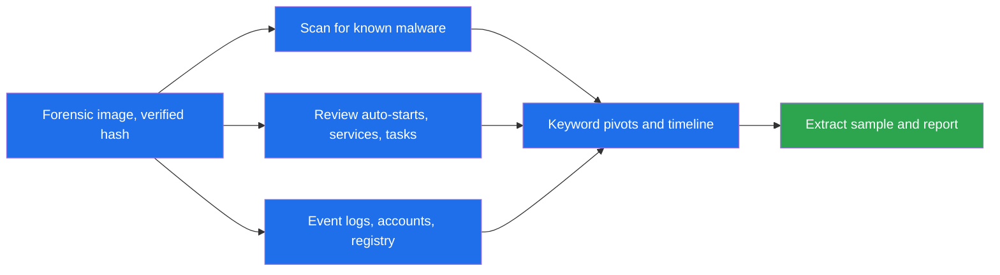

# Post-Mortem Malware Forensics on Windows Systems

## Summary

Post-mortem forensics works on a **forensic image** of a powered-down system's disk. It complements live response: you lose volatile evidence (memory, connections) but gain a complete, unchanging copy you can search exhaustively without the malware fighting back. The goals are to **find** the malware, **extract** it for analysis, and **reconstruct** how it got there and what it did.

## Key ideas

- **Class versus individuating characteristics.** Class characteristics are shared by a whole family (packer, mutex name, persistence method, C2 protocol); individuating characteristics are specific to one sample (a hash, an embedded campaign ID). Search for both: class traits find relatives you haven't seen, individuating traits prove a specific sample was here.
- **Work on a copy.** Mount the image read-only and verify hashes before and after.

## Where to look

| Area | What to check |
|---|---|
| **Known malware** | Hash and signature scans of the image with up-to-date engines and YARA rules |
| **Installed programs and suspicious executables** | Recently installed software, executables in user-writable or temp locations, names that mimic system files in the wrong folder (T1036 Masquerading) |
| **Auto-start locations** | Run keys and Startup folders (T1547.001), services and drivers (T1543.003), scheduled tasks (T1053.005). Autoruns can scan an offline Windows system (`autorunsc -z`) |
| **Event logs** | Service installation attempts (4697), scheduled task creation (4698), logons (4624), process creation (4688 if enabled) |
| **User accounts and logon activity** | New accounts, unusual logon types and times |
| **File system** | MFT timestamps, recently created files, alternate locations |
| **Registry** | Execution and user-activity artifacts (see [Registry Forensic Artifacts](../forensics/registry-forensic-artifacts.md)) |
| **Execution artifacts** | Prefetch and similar traces (see [Timeline Analysis and Execution Artifacts](../forensics/timeline-analysis-and-execution-artifacts.md)) |

## Putting it together

**Keyword searches** (C2 domains, mutex names, file names found in one artifact) pivot you to others. A **timeline** that merges file system, registry and event log timestamps shows the sequence: delivery, execution, persistence, follow-on activity. Once you've found the sample, extract it with its metadata and hand it to the malware analysis workflow.

## Practical rules

- Capture memory **before** shutdown when you can; post-mortem analysis can't recover what was only in RAM.
- Don't stop at the first sample: look for droppers, second stages and other hosts with the same class characteristics.
- Record every finding with its path, timestamp and source artifact.

## ATT&CK mapping

- **T1547.001**, **T1543.003**, **T1053.005**: persistence you'll find in the image.
- **T1036 Masquerading**: malware disguised as legitimate files.

## Explanation

Live response is interviewing witnesses at the scene; post-mortem forensics is the lab examining the evidence bags afterwards. The lab can't ask anyone questions, but it can examine every fibre slowly, and the evidence can't change its story.
