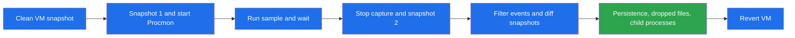

# Process and Registry Monitoring (Procmon, Process Explorer, Regshot)

## Summary

The quickest way to learn what a sample does is to run it in an isolated VM and **watch**. Basic dynamic analysis records the sample's effects on files, the registry, processes and threads, and the network. Three tool roles cover most of it: a real-time **event recorder** (Process Monitor), a live **process inspector** (Process Explorer), and a **before/after snapshot diff** of the registry and file system (Regshot or similar). Together they answer: what did it drop, what did it change to persist (T1547.001, T1112), and what did it start or inject into (T1055)?

## The tools

| Tool | Role | What Microsoft's documentation says it covers |
|---|---|---|
| **Process Monitor (Procmon)** | Records every event as it happens | Real-time file system, registry and process/thread activity, with non-destructive filters so you can change filters without losing captured data |
| **Process Explorer** | Inspects running processes | Which handles and DLLs each process has opened or loaded, shown in a process tree; can search for which process has a given handle or DLL open |
| **Autoruns** | Lists persistence | Programs configured to start automatically at boot or logon |
| **Regshot** (third-party) | Diffs two snapshots | Take a registry (and optionally file) snapshot, run the sample, take another, and compare |

## Workflow

1. **Prepare**: clean VM snapshot, network isolated or simulated, tools ready.
2. **Baseline**: take the first Regshot snapshot; start Procmon capturing; open Process Explorer.
3. **Detonate**: run the sample and wait long enough for delayed actions (sleep timers, scheduled tasks).
4. **Stop and collect**: stop Procmon, take the second snapshot, compare.
5. **Filter Procmon** down to the sample's process tree, then to the interesting operations: process creation, file writes, registry value sets.
6. **Check Autoruns** for new entries.
7. **Revert** the VM.

## What to look for

- **Child processes**: script hosts, `cmd.exe`, `powershell.exe`, or a copy of itself under a new name.
- **Dropped files**: new executables in `%AppData%`, `%Temp%` or `ProgramData`.
- **Persistence**: new Run keys, services or scheduled tasks.
- **Injection hints**: a legitimate process (e.g. `explorer.exe`) suddenly holding handles to the sample or loading an unexpected DLL. Comparing a process's strings on disk with its strings in memory can reveal a replaced (hollowed) process.
- **Security tool tampering**: services stopped or settings changed.

## Limits

Malware may detect the VM or the monitoring tools and behave differently (T1497 sandbox evasion is tracked separately). Kernel-mode components and network behaviour need other tools. Always pair dynamic results with static analysis.

## ATT&CK mapping

- **T1112 Modify Registry**, **T1547.001 Registry Run Keys / Startup Folder**: changes revealed by the registry diff.
- **T1055 Process Injection**: revealed by unexpected handles, DLLs or memory strings.

## Explanation

It is like putting a houseguest in a room with a CCTV camera (Procmon), a window into each drawer (Process Explorer), and a photo of the room before and after (Regshot). You don't need to ask what they did; you can watch, and then compare the photos.
