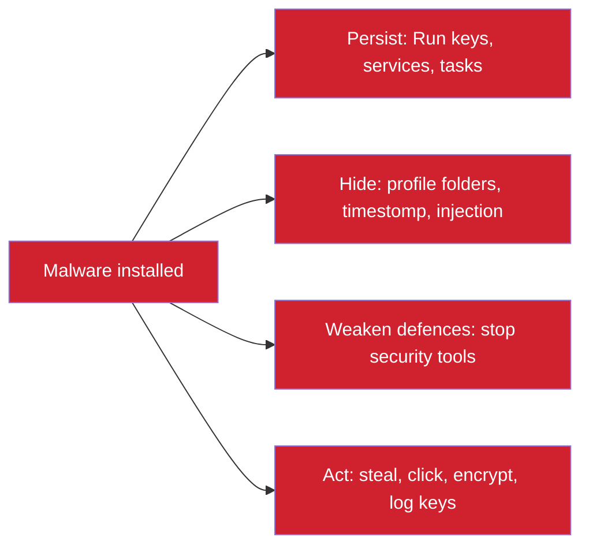

# Typical Malware Behaviors and Installation Footprints

## Summary

Malware families differ in detail but share a small set of goals once installed: **stay** on the machine, **hide**, **weaken defences**, and **make money or achieve the mission**. Each goal leaves footprints in predictable places. Knowing the common footprints is the fastest way to check a machine for an unknown infection, and to make sense of a sandbox report. The source chapter (2010) focused on consumer malware such as adware and click-fraud bots; the same footprint categories apply to today's stealers and ransomware.

## What malware does once installed

| Goal | Typical behaviours | ATT&CK |
|---|---|---|
| **Monetise / mission** | Pop-ups and search redirection (adware), click fraud, credential and data theft, keylogging, encryption for ransom | T1056.001 Keylogging and others |
| **Stay** | Run keys, Startup folder, services, scheduled tasks | T1547.001, T1543.003 |
| **Hide** | Copy itself into user-profile or system-looking folders; change file timestamps to match surrounding files; inject into legitimate processes | T1070.006 Timestomp, T1055 Process Injection |
| **Weaken defences** | Stop or disable security services, change their settings | T1685 Disable or Modify Tools |
| **Configure itself** | Store settings and state in the registry | T1112 Modify Registry |

## Where to look for footprints

- **File system**: new executables or DLLs under `%AppData%`, `%LocalAppData%`, `%Temp%`, `ProgramData`, or system-looking folders that aren't real system paths. Check timestamps against the MFT's other timestamps, since timestomping often changes only some of them.
- **Auto-start locations**: review with Sysinternals Autoruns against a known-good baseline.
- **Processes**: unusual parent/child pairs, legitimate processes with unexpected network connections or loaded modules.
- **Services and security tools**: security services stopped or set to disabled.
- **Browser**: unexpected extensions, changed home page or search provider (classic adware signs).

## Using this in practice

- **Triage checklist**: walk the footprint list on a suspect host before reaching for heavier tools.
- **Sandbox reading**: map each reported behaviour to a goal; a sample that persists, hides and disables defences is far more serious than one that just shows adverts.
- **Detection engineering**: write detections for the footprints (new Run key pointing into `%AppData%`, security service stopped) rather than for one family's hash.

## ATT&CK mapping

- **T1547.001**, **T1543.003**: persistence.
- **T1070.006 Timestomp**, **T1055 Process Injection**: hiding.
- **T1685 Disable or Modify Tools**: defence impairment.
- **T1112 Modify Registry**, **T1056.001 Keylogging**.

See also [Malware Identification and Manual Removal Procedures](malware-identification-and-manual-removal.md).

## Explanation

Every squatter needs to do the same few things: get a key cut (persistence), keep their stuff out of sight (hiding), disable the alarm (defence impairment), and then do whatever they came for. Look for spare keys, hidden boxes and a switched-off alarm, and you'll find the squatter no matter who they are.
