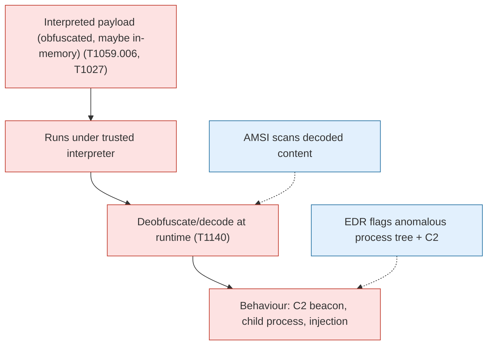

# Antivirus Evasion with Interpreted Payloads (Concepts)

## Summary

This is a defender-oriented explanation of *why* payloads written in interpreted languages (Python and similar) often slip past signature-based antivirus, and how to detect them anyway. It does not provide working offensive code. The core idea: traditional antivirus matches static signatures against files on disk, so a payload whose bytes differ each time, or that never touches disk as a recognisable executable, has nothing stable to match (command and scripting interpreter: Python, T1059.006; obfuscated files or information, T1027). Red teams exploit this to run command-and-control agents during authorised engagements. Modern defence shifts from matching file bytes to watching behaviour at runtime, which is where these payloads become visible.

## Why static AV struggles, and where defence wins

| Evasion idea (attacker) | Defensive counter |
|---|---|
| Interpreted script has no fixed binary signature | Script-block logging, AMSI scanning of script content |
| Per-build obfuscation/encoding (T1027) | Detect the *decoder* behaviour and runtime deobfuscation (T1140) |
| In-memory / reflective loading, nothing on disk (T1620) | Memory scanning, unusual loads in interpreter processes |
| Trusted interpreter runs the payload | Baseline interpreter use; alert on network C2 and child processes |

The pattern: everything an attacker does to defeat *static* matching tends to create *behavioural* signal — a decode step, an anomalous process tree, outbound C2 — which is what the defence targets.

## Detection-centric flow

## Detection

- Interpreter processes (python, scripting hosts) making unexpected outbound connections or spawning shells.
- AMSI / script-block logging capturing obfuscated or decoded content at runtime.
- Reflective or in-memory module loads inside interpreter processes (no backing file on disk).
- High-entropy encoded blobs followed by a runtime decode step, then network or injection behaviour.

## Defense

- **Behaviour-based EDR** rather than signature-only AV: watch process trees, memory, and network, not just file bytes.
- **Enable AMSI and script-block/module logging** so obfuscated scripts are inspected after they are decoded in memory.
- **Application control** to restrict which interpreters and scripts may run, and from where.
- **Network egress controls and C2 detection** to catch the beacon the payload ultimately needs.
- **Attack-surface reduction** rules limiting script and interpreter abuse by Office and other apps.

## ATT&CK mapping

| ID | Name | Tactic |
|---|---|---|
| T1059.006 | Command and Scripting Interpreter: Python | Execution |
| T1027 | Obfuscated Files or Information | Stealth |
| T1620 | Reflective Code Loading | Stealth |

## Explanation

Old-style antivirus works like a bouncer with a book of mugshots: it compares each file against known bad pictures. If an attacker changes the payload's appearance on every build, or never hands over a photo at all because the code only ever exists in memory, the mugshot book is useless. But the payload still has to *do* something — decode itself, phone home, launch a shell — and those actions are far harder to disguise than a file's bytes. So modern defence stops staring at the photo and watches behaviour instead: a trusted interpreter suddenly opening a network tunnel or spawning a command shell is suspicious no matter how the file looked on the way in.
