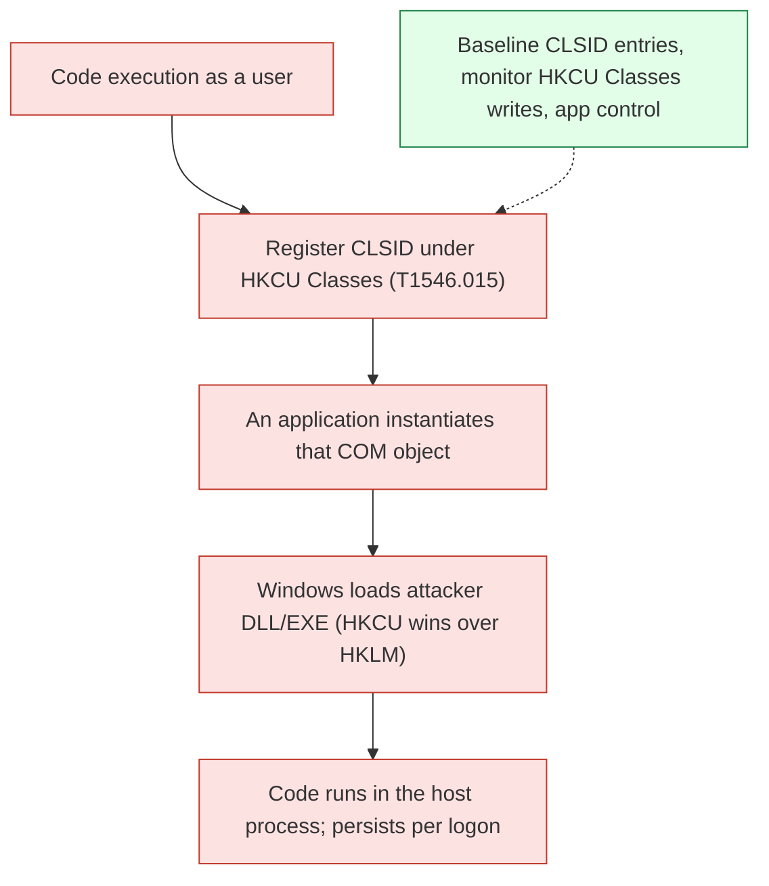

# COM Automation and COM Hijacking

## Summary

The Component Object Model (COM) is the Windows system that lets software expose reusable objects other programs can call, identified by a CLSID in the registry. Offensive tooling uses COM in two ways. **COM automation** drives trusted applications programmatically (for example automating a scripting or Office component) to execute actions and blend in with legitimate activity (inter-process communication: component object model, T1559.001). **COM hijacking** abuses the lookup order: by adding a CLSID entry under the per-user hive (`HKCU`), an attacker makes Windows load their DLL instead of the legitimate one when some application instantiates that object — yielding both execution and persistence without admin rights (event triggered execution: component object model hijacking, T1546.015). The elegance for attackers is that the trigger is a normal application calling a normal object.

## The two uses

| Use | Mechanism |
|---|---|
| **COM automation (T1559.001)** | Instantiate and call trusted COM objects to run code/actions under a trusted process |
| **COM hijacking (T1546.015)** | Register a CLSID under `HKCU\Software\Classes\CLSID\...` so `HKCU` wins over `HKLM`, loading a malicious server |
| **Abusable server types** | `InprocServer32` (DLL), `LocalServer32` (EXE), or TreatAs redirection |

`HKCU` taking precedence over `HKLM` for class registration is the crux of hijacking: a standard user can shadow a system-wide object for their own session.

## Attack flow

## Detection

- Writes to `HKCU\Software\Classes\CLSID\...\InprocServer32`/`LocalServer32`, especially pointing to user-writable paths.
- `HKCU` CLSID entries that shadow existing `HKLM` classes (abnormal, worth alerting).
- Trusted hosts (Explorer, Office, scripting hosts) loading unexpected or unsigned DLLs via COM.
- Autoruns/ASEP baselines flagging new COM-hijack entries.

## Defense

- **Baseline and monitor COM registrations**, particularly per-user CLSID entries that override system classes.
- **Application control (WDAC/AppLocker)** so a hijacked CLSID cannot load an unapproved DLL/EXE.
- **Audit registry writes** to `Classes\CLSID` locations (Sysmon registry events).
- **Least privilege and user-writable-path hygiene** to limit where malicious servers can live.
- Investigate the application that would trigger the object, not only the registry value.

## ATT&CK mapping

| ID | Name | Tactic |
|---|---|---|
| T1546.015 | Event Triggered Execution: Component Object Model Hijacking | Privilege Escalation, Persistence |
| T1559.001 | Inter-Process Communication: Component Object Model | Execution |

## Explanation

COM is Windows's way of letting programs share ready-made building blocks, each with a catalogue number (a CLSID) the system looks up in the registry to find the right block. The catch is that Windows checks the user's personal catalogue before the system-wide one, so a standard user can slip in an entry that says "for this catalogue number, use my block instead." The next time any application reaches for that building block, it quietly gets the attacker's, which both runs their code and comes back every session. Because the catalogue is finite and well understood, defenders catch this by noticing a personal entry that masks a system one — a thing that should essentially never happen in normal use.
