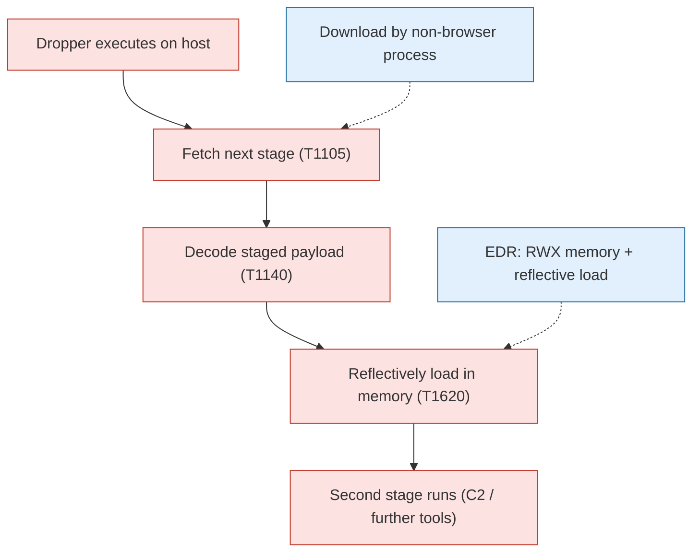

# Custom Droppers and Loaders (Concepts)

## Summary

This file explains, for defenders, the role droppers and loaders play in an intrusion, without providing malware. A **dropper** is a first-stage program whose only job is to deliver and launch a second-stage payload; a **loader** (or stager) retrieves, decodes, and executes that payload, often entirely in memory. Attackers write custom ones to avoid known signatures and to control exactly how the payload is fetched and run (ingress tool transfer, T1105; deobfuscate/decode files or information, T1140; reflective code loading, T1620). Understanding the dropper/loader pattern matters because detection often works best at the hand-off points: where the loader pulls the next stage, decodes it, and loads it without touching disk.

## Anatomy of the pattern

| Stage | Purpose | Detectable signal |
|---|---|---|
| **Dropper** | Land on the host, establish the first foothold | Odd parent process, write of a staged file |
| **Fetch (T1105)** | Retrieve the next stage over the network | Unusual outbound download by a non-browser process |
| **Decode (T1140)** | Turn an encoded blob into runnable code | Runtime decode of high-entropy data |
| **Load (T1620)** | Execute in memory, no recognisable file on disk | Reflective/manual module load, RWX memory |

Loaders favour in-memory execution precisely to avoid the on-disk artefact that signature AV relies on — but memory and behaviour telemetry still expose them.

## Loader flow

## Detection

- Non-browser processes downloading content, then shortly executing new code (fetch-then-run).
- Runtime decode of high-entropy blobs followed by execution.
- Reflective code loading: modules present in memory with no matching file on disk, RWX regions, or manually mapped PEs.
- Unusual process ancestry (document or script spawning a stager that beacons out).

## Defense

- **Behaviour/memory-based EDR** to catch reflective loads and RWX execution the file scanner misses.
- **Egress filtering and C2 detection** to break the fetch stage the loader depends on.
- **Application control** to limit what can execute and from where.
- **ASR and macro/script hardening** to stop the common dropper launch points (Office, scripts, LNKs).
- **Log and alert on download-then-execute** sequences by unexpected processes.

## ATT&CK mapping

| ID | Name | Tactic |
|---|---|---|
| T1105 | Ingress Tool Transfer | Command and Control |
| T1140 | Deobfuscate/Decode Files or Information | Stealth |
| T1620 | Reflective Code Loading | Stealth |

## Explanation

Smugglers rarely bring the whole shipment through the front gate at once. A dropper is the courier who gets a foot in the door; a loader is the accomplice who then quietly fetches the real cargo, unwraps it, and hands it straight to the end user without ever setting it on a shelf where an inspector might find it. Keeping the cargo off the shelf (running it only in memory) defeats the inspector who only checks shelves — the file scanner. But the courier still has to make the pickup, unwrap the parcel, and deliver it, and each of those moves is visible to someone watching behaviour rather than shelves, which is exactly where modern detection sits.
