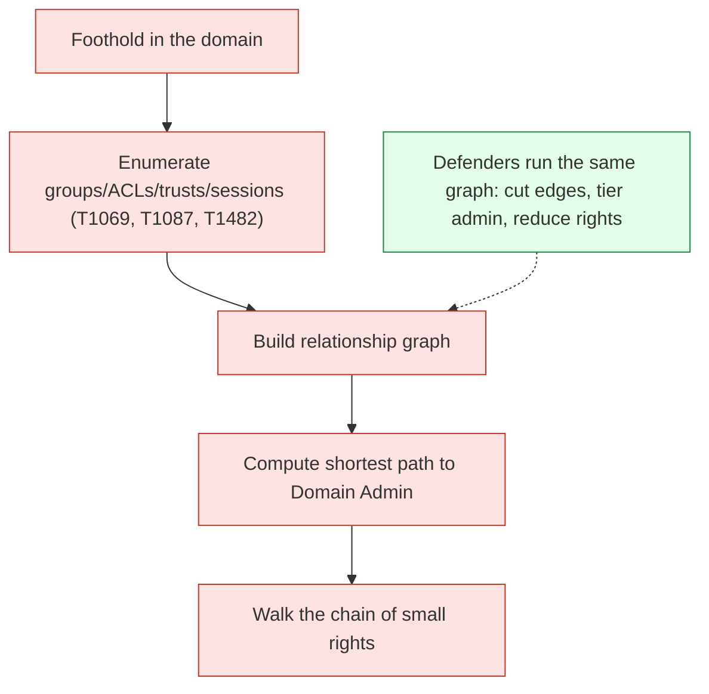

# Graph-Based Attack Path Discovery (BloodHound-Style)

## Summary

Active Directory is a web of relationships: users belong to groups, groups have rights over computers, computers trust domains, and admins can log on to many machines. Graph-based tools (BloodHound being the best known) collect this data and model it as a graph, then compute the shortest path from where an attacker stands to a high-value target like Domain Admin. The collection is mostly ordinary AD enumeration — reading group memberships, ACLs, sessions, and trusts (domain trust discovery, T1482; permission groups discovery, T1069; account discovery, T1087) — and the power comes from analysis, not exploitation. Defenders use the same graphs to find and cut those paths before an attacker walks them.

## What the graph captures

| Data collected | ATT&CK mapping |
|---|---|
| Group memberships and nesting | Permission groups discovery (T1069) |
| User and computer accounts | Account discovery (T1087) |
| Domain and forest trust relationships | Domain trust discovery (T1482) |
| ACLs/rights over objects, admin-to-host logon sessions | (analysis of collected rights and sessions) |

The insight attackers gain: escalation is rarely one big exploit; it is a chain of small, legitimate rights ("this user can reset that user's password, who is admin on that server, where a Domain Admin has a session"). The graph makes that chain visible.

## Discovery and analysis flow

## Detection

- Bulk LDAP/AD enumeration from a single host in a short window (reading many groups, ACLs, and sessions).
- Session-enumeration patterns (querying logged-on users across many machines).
- Collection tooling signatures and unusual directory-reading volume from non-administrative accounts.
- SACL-based auditing of sensitive object reads where enabled.

## Defense

- **Run the same analysis defensively**: map attack paths and remove the risky edges (excessive ACLs, nested admin groups, wide local-admin rights).
- **Tier administration** so high-privilege accounts never log on to lower-tier hosts, breaking the session-based chains.
- **Least privilege on AD objects**: trim dangerous ACLs (GenericAll, reset-password, write-DACL) that create shortcut edges.
- **Monitor** for mass directory and session enumeration.
- **Protected Users, LAPS, and credential hygiene** to shrink what a compromised node can reach.

## ATT&CK mapping

| ID | Name | Tactic |
|---|---|---|
| T1482 | Domain Trust Discovery | Discovery |
| T1069 | Permission Groups Discovery | Discovery |
| T1087 | Account Discovery | Discovery |

## Explanation

Think of Active Directory as a city where the interesting fact is not any single building but which keys open which doors and who happens to be inside right now. Attackers used to wander the city hoping to stumble onto the mayor's office; graph tools hand them a map that computes the shortest route — "borrow this clerk's key, which opens the archive, where a deputy is sitting, whose key opens city hall." The crucial point for defenders is that the same map is theirs to draw first. Running the analysis on your own directory reveals the shortcut routes, and you win not by blocking exploits but by deleting the edges — removing the stray key, separating the ranks, so the shortest path to the mayor's office simply no longer exists.
