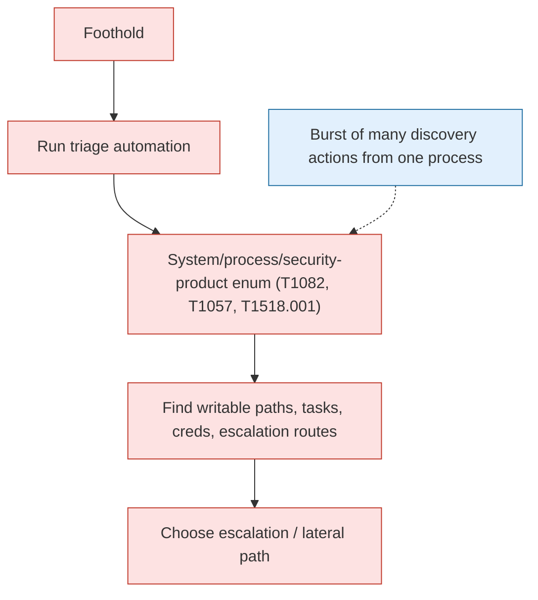

# Offensive Triage and Enumeration Automation (Concepts)

## Summary

After gaining a foothold, attackers (and authorised red teams) run automated enumeration to understand the host quickly: what OS and patches, what processes and services, what security products are present, what is misconfigured and writable, and what credentials or escalation paths exist. Tools like the "WinPEAS/Seatbelt" class automate this triage. The individual actions are standard discovery — system information discovery (T1082), process discovery (T1057), security software discovery (T1518.001) — but doing them all at once, fast, is itself a detectable signature. For defenders, understanding what this automation collects tells you both what to harden and what enumeration bursts to alert on.

## What triage automation collects

| Category | ATT&CK mapping |
|---|---|
| OS, patch level, architecture, environment | System information discovery (T1082) |
| Running processes and their owners | Process discovery (T1057) |
| Installed AV/EDR and security tooling | Security software discovery (T1518.001) |
| Services, scheduled tasks, writable paths, ACLs | (privilege-escalation enumeration) |
| Stored credentials, tokens, autologon, saved sessions | (credential discovery) |

The attacker's goal is a fast map of weaknesses; the defender's advantage is that this "collect everything now" behaviour is abnormal for a legitimate user and clusters many discovery actions into a short window.

## Enumeration flow

## Detection

- A burst of many discovery commands/API calls from a single process in a short window (classic triage signature).
- Known enumeration-tool patterns and command-line signatures.
- Security-software discovery (querying installed AV/EDR), which legitimate users rarely do.
- Reading of many ACLs, services, scheduled tasks and credential stores in sequence.

## Defense

- **Alert on discovery bursts** — correlation of system/process/security-product enumeration from one source.
- **Harden what triage looks for**: strong ACLs, no stored plaintext credentials, no autologon secrets, quoted service paths, least privilege.
- **Command-line and script-block logging** to capture enumeration tooling.
- **Reduce local information leakage** (minimise cached credentials, apply LAPS, Credential Guard).
- Treat an enumeration burst as an early intrusion stage and investigate the source process.

## ATT&CK mapping

| ID | Name | Tactic |
|---|---|---|
| T1082 | System Information Discovery | Discovery |
| T1057 | Process Discovery | Discovery |
| T1518.001 | Software Discovery: Security Software Discovery | Discovery |

## Explanation

When a burglar gets inside, the first thing they do is walk every room, try every drawer, and note which windows don't lock — fast, before anyone notices. Offensive triage automation is that walkthrough turned into a single script: in seconds it inventories the machine, the running programs, the alarm system, and every unlocked drawer. The very thoroughness that makes it useful to the attacker is what gives them away, because no ordinary occupant checks every lock in the house at once. So defenders do two things: remove the unlocked drawers the script is hunting for (tight permissions, no stashed credentials), and listen for the unmistakable sound of someone trying every door in rapid succession.
