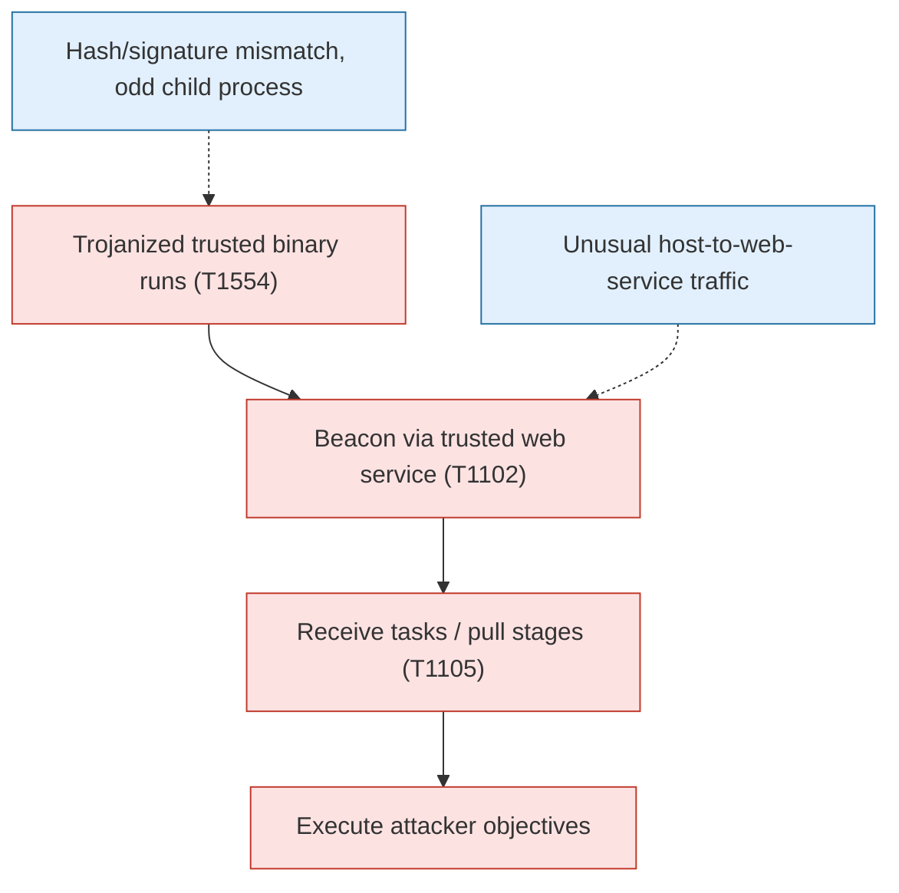

# Web-Service C2 and Trojanized Binaries (Concepts)

## Summary

This file explains two blending techniques for defenders, without supplying tooling. **Web-service C2** routes command-and-control through a legitimate, widely-trusted web service (a code-hosting, pastebin, or collaboration platform) so the beacon traffic looks like ordinary HTTPS to a normal domain (web service, T1102). **Trojanizing a binary** means taking a legitimate program the user trusts and modifying it to also carry attacker code, so running the familiar application silently runs the payload (compromise host software binary, T1554), often paired with fetching further stages (ingress tool transfer, T1105). Both techniques trade stealth for reliance on trusted infrastructure, which is also where their detectable seams lie.

## The two techniques

| Technique | How it blends in | Where it shows |
|---|---|---|
| **Web-service C2 (T1102)** | Beacon via a popular service's domain/API over TLS | Anomalous access patterns/volume to that service from servers |
| **Trojanized binary (T1554)** | Attacker code rides inside a trusted application | Changed hash/signature, unexpected child processes/network |
| **Staging (T1105)** | Pull further payloads once running | Download by a process that shouldn't download |

The weakness for defenders to exploit: trusted services and trusted binaries have *expected* behaviour, so deviations (a build server talking to a chat API, a signed app spawning a shell) stand out even when the destination or file looks benign.

## Attack flow

## Detection

- Servers or workstations contacting a trusted web service they have no business using, or with beacon-like regularity.
- Signed/trusted applications whose on-disk hash no longer matches the vendor's, or whose signature is broken.
- A trusted binary spawning unexpected child processes or making outbound connections it normally never makes.
- Download-then-execute behaviour sourced from an otherwise-legitimate application.

## Defense

- **Behavioural baselines** per host/application: flag a trusted process doing untrusted things (new network, new children).
- **Binary integrity**: verify signatures and known-good hashes; application control to block tampered binaries.
- **Egress and TLS inspection / service-specific policy** so even trusted-domain C2 shows anomalous usage.
- **Supply-chain and update hygiene** to reduce trojanized-binary delivery.
- **Correlate** file-integrity, process-ancestry and network telemetry rather than trusting the destination domain alone.

## ATT&CK mapping

| ID | Name | Tactic |
|---|---|---|
| T1102 | Web Service | Command and Control |
| T1105 | Ingress Tool Transfer | Command and Control |
| T1554 | Compromise Host Software Binary | Persistence |

## Explanation

Two of the best disguises are a crowd and a uniform. Routing command traffic through a hugely popular web service is hiding in a crowd: your beacon is one more connection to a domain everyone's machines already talk to. Trojanizing a trusted program is wearing a uniform: the user runs the application they always run, not realising it now does something extra. Both disguises work against anyone who only checks the destination or the label. They fail against someone who knows how that crowd member or uniformed worker normally behaves — a build server that suddenly chats with a messaging API, or a signed app that suddenly spawns a command shell, is out of character, and out-of-character is what behavioural detection is built to notice.
