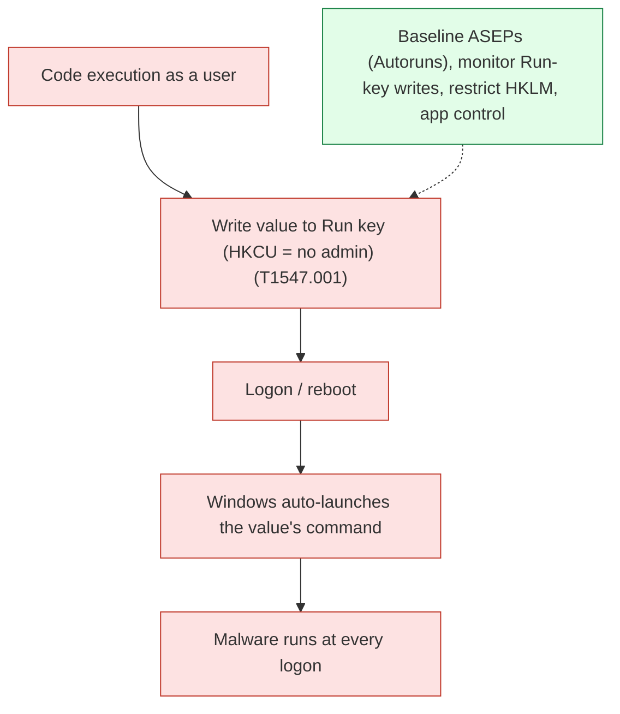

# Registry Run Keys and Autostart Extensibility Points

## Summary

Windows reads a set of registry locations at logon and boot and automatically launches whatever they point to. Attackers add an entry to one of these so their code runs every time the user logs in or the machine starts (boot or logon autostart execution: registry run keys / startup folder, T1547.001). The classic keys are `Run` and `RunOnce` under both `HKCU` (per-user, no admin needed) and `HKLM` (all users, needs admin). These are only the best-known of a much larger set of **Autostart Extensibility Points (ASEPs)** — the many registry values and folders Windows consults to start things automatically. Persistence here is popular because a per-user Run key needs no special privilege and survives reboots.

## Common autostart locations

| Location | Scope / trigger |
|---|---|
| `HKCU\...\CurrentVersion\Run` / `RunOnce` | Current user, at that user's logon (no admin) |
| `HKLM\...\CurrentVersion\Run` / `RunOnce` | All users, at logon (needs admin) |
| `...\Policies\Explorer\Run` | Enforced via policy, at logon |
| `Winlogon` `Userinit` / `Shell` values | At logon, before the shell loads |
| `HKLM\...\RunServices` and service autostart | At boot (see Windows Service persistence) |

`RunOnce` entries are deleted after they execute once, which malware sometimes abuses for a single re-launch; `Run` entries persist indefinitely until removed.

## Persistence flow

## Detection

- Writes/modifications to Run, RunOnce and Winlogon values, especially in `HKCU` by non-installer processes.
- Autostart values pointing to user-writable paths (`%AppData%`, `%Temp%`), scripts, or LOLBins.
- New ASEP entries that deviate from a known-good baseline (e.g. Sysinternals Autoruns output).
- A process writing an autostart value then the same binary launching at the next logon.

## Defense

- **Baseline and monitor ASEPs** with tools like Autoruns; alert on new or changed entries.
- **Restrict `HKLM` autostart keys** to administrators and monitor changes there closely.
- **Application control (WDAC/AppLocker)** so an autostart value cannot run an unapproved binary even if planted.
- **Audit registry writes** to the key autostart locations (Sysmon registry events).
- Remove unexpected entries and investigate the writing process, not just the value.

## ATT&CK mapping

| ID | Name | Tactic |
|---|---|---|
| T1547.001 | Boot or Logon Autostart Execution: Registry Run Keys / Startup Folder | Persistence, Privilege Escalation |
| T1547 | Boot or Logon Autostart Execution | Persistence, Privilege Escalation |

## Explanation

Windows keeps several to-do lists that it works through automatically every time you log in or switch the machine on — "launch this, then this." Adding yourself to one of those lists is the simplest way to make sure your program comes back after every reboot, and the per-user list needs no special permission at all. That convenience is exactly why defenders keep an inventory of everything on those lists: because the lists are finite and well known, a new, unexplained entry stands out, and comparing today's lists against a trusted snapshot is one of the most reliable ways to catch persistence.
